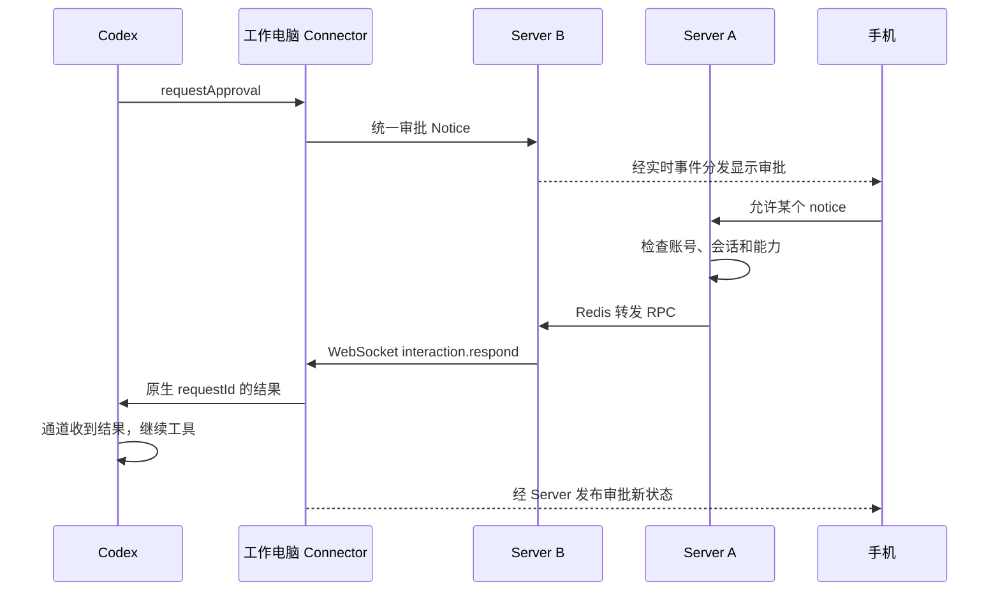

# 审批架构解密：点下“允许”之后，程序到底怎样继续

让 AI 帮忙发一封邮件。AI 已经写好了收件人和正文，但发出去之前，要先问你：“可以发送吗？”

你关掉网页，吃完饭，重新打开，再点“允许”。邮件这时才发出去。

这里有几个很实在的问题：你不在时，程序停在哪里？它把什么存进了数据库？你回来以后，服务器怎么知道要继续哪件事？“允许”两个字，最后怎么变成了一次真正的发送？

我们顺着这封邮件走一遍。先看 LangChain 和 LangGraph，再看 Codex，最后看跨设备的 Agents Anywhere（简称 AA）。它们是不同系统，不是彼此依赖的三层代码。

另外两篇：[Plan 模式](02-Plan模式：原生规划与版本化审批.md)、[目标模式](03-目标模式：持久状态与自动续跑.md)。

## 1. 先认识三个角色

把整个系统想成一家餐厅：

- **模型**像提出建议的人：“这封邮件可以这样发。”
- **执行程序**像真正干活的人：检查权限，然后调用发邮件工具。
- **服务器**像服务台：收用户请求、安排执行、把需要确认的事情送到网页。

数据库是服务台的记录本。它可以记住“这桌还有一道菜等确认”，但它自己不会做菜，也不会主动叫醒程序。

审批的第一道关口在执行程序里：**先拿到决定，再允许工具产生实际影响。** 只在聊天中写“请确认”，却已经调用了发送接口，是来不及的。

## 2. LangChain：模型先提出调用，工具还没有执行

用户说：“把发布通知发给团队。”模型返回的内容，可以理解为：

```json
{
  "id": "call-17",
  "name": "send_email",
  "args": {
    "to": "team@example.com",
    "body": "新版本已经发布。"
  }
}
```

这份数据叫“工具调用”：工具名是 `send_email`，参数是收件人和正文。`call-17` 是这一调用的编号。

LangChain v1 可以加一个人工审批中间件。中间件就是插在流程中间的一段检查程序。这里讨论源码中的批量审批路径：模型回答之后，中间件的 `after_model()` 先检查工具调用，再决定是否放行。

```text
用户提任务
  → 调模型
  → 收到工具调用 call-17
  → 审批中间件发现 send_email 需要确认
  → 暂停
  → 此时还没有调用 send_email
```

中间件把工具名、参数、说明和允许的决定整理好，然后调用 LangGraph 的 `interrupt()`。LangGraph 是负责安排这些执行步骤的框架。

这份待审内容的主要部分是：

```json
{
  "action_requests": [
    {"name": "send_email", "args": {"to": "team@example.com", "body": "新版本已经发布。"}}
  ],
  "review_configs": [
    {"action_name": "send_email", "allowed_decisions": ["approve", "edit", "reject"]}
  ]
}
```

注意：这不是又问了一次模型。它是在等一个来自人的结构化答案。[查看中间件实现](https://github.com/langchain-ai/langchain/blob/6eb20afecc770e65c061a4d042f1aab2256e1d02/libs/langchain_v1/langchain/agents/middleware/human_in_the_loop.py)。

## 3. “暂停”不是让 HTTP 请求一直挂着

如果把 LangGraph 接到服务器上，一种常见流程是：

```text
第一次 HTTP 请求开始
  → 执行到 interrupt
  → 保存执行状态和中断信息
  → 返回“需要用户确认”
第一次 HTTP 请求结束

用户稍后点允许

第二次 HTTP 请求开始
  → 读取之前保存的状态
  → 带着用户决定重新启动执行
```

**任务在等人，不代表一个服务器线程要一直坐在那里等人。** 请求可以结束，网页也可以断开；能恢复所依赖的是已经保存好的状态。

但“有服务器”不自动等于“已经写入数据库”。服务器必须使用持久化存储。只配置内存保存器时，程序重启仍会丢记录。

下面具体看 `AsyncPostgresSaver`。它是 LangGraph 提供的 PostgreSQL 保存器，“Saver”可以理解成负责写记录和读记录的程序。这里跟踪这个开源保存器的细节；托管 Agent Server 的内部部署表，不应直接假定与它完全相同。

## 4. 数据库不是只保存一行“待审批”

为了恢复，框架需要知道：之前聊了什么、模型提出了哪个工具调用、哪个步骤还没做完、哪个任务正在等答案。

PostgreSQL 保存器主要把这些信息分放在三张表里：

| 表名 | 可以怎样理解 | 关键内容 |
| --- | --- | --- |
| `checkpoints` | 一次执行的存档目录 | 存档编号、父存档、步骤信息、各份状态的版本 |
| `checkpoint_blobs` | 目录对应的具体内容 | 消息列表等较复杂的数据，以带类型的字节保存 |
| `checkpoint_writes` | 当前任务的补充记录 | 中断信息、恢复答案、已经完成的任务写入 |

先认识几个编号，后面用同一组例子：

| 编号 | 示例 | 用来找什么 |
| --- | --- | --- |
| `thread_id` | `thread-8` | 哪个会话 |
| `checkpoint_ns` | 空字符串 | 哪一层图；子图可以有自己的命名空间 |
| `checkpoint_id` | `cp-42` | 哪次存档 |
| `task_id` | `task-9` | 哪个执行任务 |
| 工具调用 ID | `call-17` | 哪次发邮件调用 |

这些编号不能互相替代。一段对话会有很多次存档，一次执行里也可能有多个任务。

## 5. 第一次执行时，存档具体怎么写

执行框架会在步骤边界保存状态。假设模型已经提出发邮件调用，下一步要进入审批，中断所依赖的存档已经记录了这份模型消息。

`AsyncPostgresSaver.aput()` 收到存档后，会拆开处理 `channel_values`。这里的 channel 可以理解成一份有名字的状态，例如 `messages` 就是消息列表。

- 字符串、数字、布尔值等简单值，可以直接留在 `checkpoints.checkpoint` 的 JSONB 中。
- 消息对象、列表等复杂值，从那里拆出来，交给序列化器，放进 `checkpoint_blobs`。
- `channel_versions` 保留每份状态对应的版本，之后用它找回正确的内容。

序列化就是“把程序里的对象变成能保存的字节”。数据库里的 `type` 告诉读取程序应该用什么方式解码，`blob` 列保存字节。因此不能指望所有内容都是一眼可读的 JSON 文本。

下面是方便阅读的**解码示意**，编号也作了简化：

```json
{
  "thread_id": "thread-8",
  "checkpoint_id": "cp-42",
  "parent_checkpoint_id": "cp-41",
  "checkpoint": {
    "channel_values": {},
    "channel_versions": {"messages": "version-6"},
    "versions_seen": {"model": {"messages": "version-5"}}
  }
}
```

`checkpoint_blobs` 中对应：

| thread_id | channel | version | blob 解码后包含什么 |
| --- | --- | --- | --- |
| thread-8 | messages | version-6 | 用户消息、模型消息，以及 call-17 的名称与参数 |

为什么要记录 `versions_seen`？框架要知道每个节点上次已经看过什么。结合状态版本和图的连接关系，它才能安排后面的任务，避免所有步骤从头乱跑。

写入时，内容表按“会话 + 命名空间 + channel + version”去重；存档表按“会话 + 命名空间 + 存档编号”写入或更新。并不是每次都把整个数据库覆盖一遍。

来源：[aput 实现](https://github.com/langchain-ai/langgraph/blob/5aadf2bfb6ae956289dc05c284212ddd43cda2f7/libs/checkpoint-postgres/langgraph/checkpoint/postgres/aio.py)、[表结构、SQL 和序列化](https://github.com/langchain-ai/langgraph/blob/5aadf2bfb6ae956289dc05c284212ddd43cda2f7/libs/checkpoint-postgres/langgraph/checkpoint/postgres/base.py)。

## 6. 执行到 interrupt，真正新增的是什么

`interrupt()` 先看这个任务有没有对应的恢复答案。第一次当然没有，于是抛出 `GraphInterrupt`。

这里的“抛出”不表示程序崩溃。它是一种约定好的信号：“这个任务现在需要外部输入。”

执行器的 `commit()` 识别到它，产生一条特殊写入：

```text
channel = __interrupt__
value   = 中断对象，其中包含待审内容和中断身份
```

接着经过下面的调用链保存：

```text
interrupt()
  → GraphInterrupt
  → 执行器识别中断
  → put_writes(task_id, 写入列表)
  → AsyncPostgresSaver.aput_writes()
  → _dump_writes() 编码
  → 写 checkpoint_writes
```

数据库记录可以这样理解：

| thread_id | checkpoint_id | task_id | idx | channel | blob 解码后的含义 |
| --- | --- | --- | --- | --- | --- |
| thread-8 | cp-42 | task-9 | -3 | `__interrupt__` | 发邮件的待审内容及中断身份 |

`idx=-3` 是这里所用源码的中断专用位置，恢复答案用另一个特殊位置 `-4`。普通任务写入还会用各自的序号。表的唯一键包含会话、命名空间、存档、任务和位置，特殊记录重写时可以更新原位置。

所以，“暂停状态”分布在两类记录里：**存档保留执行现场，中断写入保留这个现场正在等待什么。** 不只是给某个 status 字段写上 paused。

图的外层处理这次中断，向调用方返回待答内容。正常结束这次调用的清理过程会等待所管理的保存工作；应用仍须正确管理保存器连接和保存策略。存档与任务补充写入是不同写入步骤，不能画成一个包住整次人工等待的大事务。

来源：[执行器处理中断](https://github.com/langchain-ai/langgraph/blob/5aadf2bfb6ae956289dc05c284212ddd43cda2f7/libs/langgraph/langgraph/pregel/_runner.py)、[执行循环](https://github.com/langchain-ai/langgraph/blob/5aadf2bfb6ae956289dc05c284212ddd43cda2f7/libs/langgraph/langgraph/pregel/_loop.py)、[特殊写入位置](https://github.com/langchain-ai/langgraph/blob/5aadf2bfb6ae956289dc05c284212ddd43cda2f7/libs/checkpoint/langgraph/checkpoint/base/__init__.py)。

## 7. 用户点“允许”，谁来启动恢复

数据库不会自己发出唤醒信号。**用户的新请求进入服务器，服务器再次调用图，才是恢复的触发点。**

自建服务器可以把接口设计成下面这样，实际项目还需要鉴权和并发控制：

```python
# 用来解释流程，不是完整服务器代码
async def approve(thread_id, decision):
    check_user_owns_thread(thread_id)
    return await graph.ainvoke(
        Command(resume=decision),
        config={"configurable": {"thread_id": thread_id}},
    )
```

对于 LangChain 的批量审批，决定形状是：

```json
{"decisions": [{"type": "approve"}]}
```

官方 Agent Server 的公开接口也采用“同一 thread 上提交 resume 命令”的方式，可经 `/threads/{thread_id}/runs/wait` 提交。一次恢复可以由新的执行任务承担，不要求原 HTTP 请求继续存活。[官方 Server 恢复接口](https://docs.langchain.com/langsmith/add-human-in-the-loop)。

请求一定要找到**原会话**。把 thread_id 换成新编号，就像拿错存档槽：新会话里没有刚才的待审任务。

## 8. 恢复时，数据库按什么顺序被读回来

图开始执行时，异步执行循环调用 `aget_tuple()`：

1. 从配置取 thread_id、checkpoint_ns，以及可选的 checkpoint_id。
2. 指定存档编号就读那份；未指定时，按编号倒序取该会话和命名空间的最新存档。
3. 读取 `checkpoints` 中的存档目录。
4. 根据目录里的 `channel_versions`，关联 `checkpoint_blobs`，取对应版本的内容。
5. 读取该存档关联的 `checkpoint_writes`，取得任务写入、中断等信息。
6. 按各记录的 type 解码字节，重新拼成程序里的状态。

概念上的查询是：

```sql
-- 说明查找条件；实际代码会同时关联内容与任务写入
SELECT checkpoint_id, checkpoint
FROM checkpoints
WHERE thread_id = :thread_id
  AND checkpoint_ns = :namespace
ORDER BY checkpoint_id DESC
LIMIT 1;
```

返回的不仅是一份聊天记录，还包括父存档、元数据和 pending_writes。执行循环用它重建各份状态，再结合已部署的图代码，安排尚未完成的任务。

程序代码本身不在这些表里。恢复需要兼容的图定义、工具和配置；数据库没有保存一个完整操作系统进程。

来源：[aget_tuple 与解码](https://github.com/langchain-ai/langgraph/blob/5aadf2bfb6ae956289dc05c284212ddd43cda2f7/libs/checkpoint-postgres/langgraph/checkpoint/postgres/aio.py)、[关联读取 SQL](https://github.com/langchain-ai/langgraph/blob/5aadf2bfb6ae956289dc05c284212ddd43cda2f7/libs/checkpoint-postgres/langgraph/checkpoint/postgres/base.py)。

## 9. “允许”怎么变成 interrupt 的返回值

这是恢复的核心。

新请求中的 `Command(resume=...)` 被执行循环转换成 `__resume__` 写入。单个中断可以先走公共恢复值；多个中断则需要按中断身份指定答案，避免答错任务。

执行框架为待恢复任务准备一份临时工作记录，源码叫 scratchpad。里面放着这个任务已有的恢复答案和当前中断序号。

然后，原来的审批节点**从头再执行一次**：

```text
再次进入审批中间件
  → 从保存的模型消息重新整理待审工具
  → 再次调用 interrupt(同一处待审内容)
  → interrupt 发现已有恢复答案
  → 返回 {decisions: [{type: approve}]}
  → 不再抛中断
```

源码中的 `interrupt()` 会按中断顺序取答案。消耗公共答案时，还会把答案放到当前任务的恢复列表，产生任务自己的 `__resume__` 写入，供后续恢复使用。

因此不是“跳回内存里的某一行”。更像重新打开存档，重新走到门口，这次手上已经有通行证。

中断前的代码可能重复执行。发邮件不能放在中断前，否则恢复时可能先发第二遍邮件，再走到审批。

来源：[Command 处理](https://github.com/langchain-ai/langgraph/blob/5aadf2bfb6ae956289dc05c284212ddd43cda2f7/libs/langgraph/langgraph/pregel/_loop.py)、[任务恢复答案的准备](https://github.com/langchain-ai/langgraph/blob/5aadf2bfb6ae956289dc05c284212ddd43cda2f7/libs/langgraph/langgraph/pregel/_algo.py)、[interrupt 读取答案](https://github.com/langchain-ai/langgraph/blob/5aadf2bfb6ae956289dc05c284212ddd43cda2f7/libs/langgraph/langgraph/types.py)。

## 10. 邮件终于被发送：审批流程最后还没有结束

中间件拿到决定后：

| 决定 | 后续动作 |
| --- | --- |
| approve | 保留 call-17 的原参数，允许进入工具执行 |
| edit | 用用户修改的参数替换原参数，继续使用原调用 ID |
| reject | 生成关联 call-17 的错误工具结果，告诉模型用户拒绝了 |

批准后，工具执行节点真正调用邮件服务。工具结果再进入消息状态；后续步骤和检查点继续被保存，模型据此给用户回复。

完整流程是：

```text
提出工具调用 → 保存现场 → 写中断记录 → 返回用户
用户决定 → 新请求 → 读现场 → 写恢复答案
重跑待审节点 → interrupt 返回答案 → 处理决定
执行或拒绝工具 → 保存结果 → 继续模型流程
```

“用户只点一次”和“外部邮件只发送一次”仍是两个问题。若邮件已发出、结果保存前程序崩溃，工具重试可能重复发送。实际邮件服务需要稳定业务编号等去重办法，checkpoint 不能替外部系统解决所有重复操作。

## 11. Codex 也在等决定，但这次等的是内存里的回执

现在换到 Codex：模型想执行一条需要审批的命令。

工具执行层先判断权限。并非所有工具都问人：已有授权、沙箱策略和自动审查等因素会影响路径。这里只跟踪确实需要人工批准的情况。

Codex app-server 创建一个 `oneshot` 通道。“one shot”就是只交付一次的回执通道：一端留给等待者，一端留给收到回答的人。

```text
准备命令审批
  → 创建 requestId
  → 创建一次性通道 sender / receiver
  → 在待答映射中保存 requestId → sender
  → 给控制客户端发审批请求
  → 处理任务 await receiver
```

请求示意：

```json
{
  "id": 73,
  "method": "item/commandExecution/requestApproval",
  "params": {
    "threadId": "thread-a",
    "turnId": "turn-b",
    "itemId": "call-c",
    "command": "需要额外权限的命令"
  }
}
```

用户批准后，客户端回复同一个 73：

```json
{"id":73,"result":{"decision":"accept"}}
```

app-server 检查回应连接的资格，取出该请求的 sender，把结果送进去。等待 receiver 的任务因此得到结果，将它转换成内部 ReviewDecision，再让工具继续、拒绝或中止。

这里没有经历 LangGraph 那种“读 PostgreSQL → 重建图任务 → 重跑节点”的恢复。当前链路依赖原生进程里的通道与待答映射。进程没了，历史还在，也不能用旧编号复活那个通道。

来源：[待答通道管理](https://github.com/openai/codex/blob/ac91c14443c11c4279a9305099354e443c6fa7d4/codex-rs/app-server/src/outgoing_message.rs)、[审批回执到执行决定](https://github.com/openai/codex/blob/ac91c14443c11c4279a9305099354e443c6fa7d4/codex-rs/app-server/src/bespoke_event_handling.rs)。

## 12. AA：把电脑上的待答请求送到手机

AA 的 Connector 在工作电脑上连接 Codex。用户可以在 Web、Desktop、Android 或 iOS 上答复。

这次假设 Connector 连着 Server B，手机请求却落到 Server A。



图中从 B 到手机的箭头省略了实时订阅分发层；它不是说手机必须直接连在 B 上。

## 13. 第一程：Connector 保存哪份等待，发出什么数据

AA 的 Codex SDK 适配路径还会创建一个 `asyncio.Future`。可以把它理解成一个“稍后会装进答案的盒子”。

```text
_pending_approval_responses[requestId]
  → PendingServerRequest
      → response Future
```

SDK 回调把审批交给异步处理程序；异步程序登记 Future，发布审批，随后等待这个盒子装入答案。AA 将原生请求变成统一的 SessionNotice：

```json
{
  "noticeId":"notice_approval_x",
  "sessionId":"session-a",
  "type":"interaction",
  "interactionType":"approval",
  "status":"open",
  "responseRequired":true,
  "actions":[{"actionId":"approve","label":"Approve"}],
  "context":{
    "approvalSource":{
      "requestId":73,
      "method":"item/commandExecution/requestApproval",
      "threadId":"thread-a"
    }
  }
}
```

noticeId 是 AA 页面上的交互编号；原生 requestId 用来找到 Codex 的等待。实际 SDK 适配路径也可能生成自己的请求键，不能跨层假设编号相同。

等待用户期间，SDK 的消息读取器继续收其他消息，避免整个读取通道被一个审批堵死。[Future 管理](https://github.com/anywhere-labs/Agents-Anywhere/blob/1f827133d6d6de86df424898d9b9738b6b3aebf3/connector/connector/runtimes/codex/sdk/client.py)、[读取器](https://github.com/anywhere-labs/Agents-Anywhere/blob/1f827133d6d6de86df424898d9b9738b6b3aebf3/connector/connector/runtimes/codex/sdk/server_requests.py)。

## 14. 第二程：Redis 怎样帮 Server A 找到 B

默认键名前缀下，AA 保存 Connector 在线位置：

```text
键：agents-anywhere:connector:presence:connector-1
类型：String
值：{"instanceId":"server-b","connectionId":"connection-7","ready":true}
```

这条记录带过期时间，由心跳续期。“租约”就是这种需要定期续费的占用记录。`connectionId` 区分新旧连接，防止把请求送给已经失效的旧连接。

A 读到 owner 是 B 后，生成一个路由编号 `route-x`，在 A 的内存里登记等待回执的 Future，然后发布到：

```text
agents-anywhere:channel:connector-rpc:server-b
```

发布内容包含原 RPC，并补充：

```json
{"requestId":"route-x","sourceInstanceId":"server-a","connectionId":"connection-7"}
```

B 订阅自己的频道，检查 connectionId 仍属于当前连接，才把 RPC 发给 Connector。B 向 Connector 发请求时又有自己的 RPC 编号和本地 Future。收到结果后，再通过 A 的频道将 `route-x` 的回执发回去。

所以这里至少有三种编号：跨实例 route ID、Server 到 Connector 的 RPC ID、原生审批 ID。它们层层包裹、各自负责匹配，不是一张共用的审批表。

Pub/Sub 是实时广播，不保存等待消费者稍后来取的消息。数据库租约也不能代替内存 Future。[查看真实键名和路由实现](https://github.com/anywhere-labs/Agents-Anywhere/blob/1f827133d6d6de86df424898d9b9738b6b3aebf3/server/agent_server/infra/connector_rpc.py)。

## 15. 第三程：点击回应后，答案如何一路返回

手机提交：

```text
POST /api/v2/sessions/{sessionId}/runtime/notices/{noticeId}/respond
```

请求里带 actionId 和补充输入。Server 检查用户拥有会话、交互能力可用，再发送 `interaction.respond`。

Connector 找到 notice 的原生上下文，把 AA 的 `approve` 翻译成 Codex 所需的结果。例如命令审批通常是 `decision=accept`；额外权限审批则是 scope 与 permissions，不能用一种格式套全部请求。

SDK 适配器从 pending map 取出对应 Future，调用 `set_result()`。之前等待它的异步程序继续，SDK 回调拿到结果，协议读取器将结果写回 Codex。Codex 原生 oneshot 随后收到结果，工具执行才继续。

```text
手机 actionId
  → AA RPC
  → Connector 转换决定
  → SDK Future.set_result
  → SDK 回调返回
  → 写原生审批结果
  → Codex oneshot receiver 得到结果
  → 工具层继续
```

Connector 还会发布 responding、resolved 等状态变化，各端更新界面。但“回复已交给 SDK”和“命令已经执行成功”不是同一件事，命令结果要看后续执行事件。

来源：[HTTP 入口](https://github.com/anywhere-labs/Agents-Anywhere/blob/1f827133d6d6de86df424898d9b9738b6b3aebf3/server/agent_server/api/sessions.py)、[决定转换](https://github.com/anywhere-labs/Agents-Anywhere/blob/1f827133d6d6de86df424898d9b9738b6b3aebf3/connector/connector/runtimes/codex/domain/approvals.py)、[回应控制器](https://github.com/anywhere-labs/Agents-Anywhere/blob/1f827133d6d6de86df424898d9b9738b6b3aebf3/connector/connector/runtimes/codex/turns/interactions.py)。

## 16. AA 的 PostgreSQL 在这条链里有没有“暂停存档”

对于这条普通原生审批链，AA 当前架构没有像 LangGraph checkpointer 那样，把原生执行现场存入 PostgreSQL，然后重跑一个节点。

AA PostgreSQL 保存用户、会话、Timeline 等长期记录；当前原生审批由 Runtime 侧持有，通过 Connector 拉取 notices 和推送变化。历史里出现审批，不等于数据库里存在一个可恢复的原生等待。

Redis 的会话状态缓存也是另一件事：

```text
agents-anywhere:session-runtime-state:{sessionId}
```

它保存执行状态 JSON，过期时间为 24 小时，按 updatedSeq 拦截较旧更新。它能帮助页面显示状态，不能唤醒 Codex 原生通道。

AA 的 Plan 有专门的 PostgreSQL 文档和操作表，下一篇会展开。不要把 Plan 文档保存误当成普通工具审批执行栈保存。[状态归属](https://github.com/anywhere-labs/Agents-Anywhere/blob/1f827133d6d6de86df424898d9b9738b6b3aebf3/docs/server-architecture.md)、[执行状态缓存](https://github.com/anywhere-labs/Agents-Anywhere/blob/1f827133d6d6de86df424898d9b9738b6b3aebf3/server/agent_server/services/session_runtime_state_cache.py)。

## 17. 用“断电后还剩什么”检查是否理解

| 情况 | 数据或等待还在吗 | 怎样继续 |
| --- | --- | --- |
| LangGraph 网页关了，数据库存档已写好 | 执行存档仍在 | 新请求带同一 thread 和 resume 读回执行 |
| LangGraph 执行进程重启 | 持久存档仍在，内存不在 | 兼容图程序加载存档后恢复 |
| AA 手机关闭 | 原生程序可能仍在等 | 重开后拉当前 notices，再回应 |
| AA Server 重启 | 其本地 RPC Future 消失，原生等待不一定消失 | 重建连接、重新拉状态 |
| Connector 重启 | SDK Future 消失 | 核对原生是否仍可回应，不能复活旧 Future |
| Codex 原生进程重启 | 原生 oneshot 消失 | 历史不能直接恢复该等待；要由原生建立新的有效流程 |

“保存了待审文字”和“保存了能继续执行的现场”是两种能力。理解了这点，再看计划审批和目标续跑，就能判断每个数据库字段到底在负责什么。
