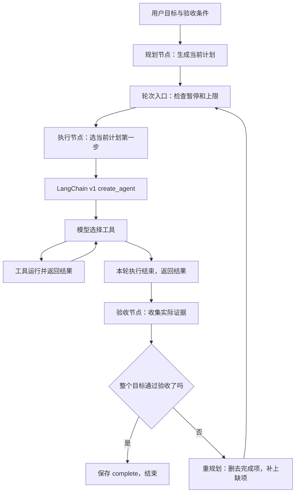

# 目标模式解密：用 LangChain v1 把规划、执行、验收和下一轮连起来

你让 AI：“修好登录问题，验证通过以后再结束。”第一轮找到原因，第二轮修改，第三轮验证发现遗漏，于是再修一次。

“每轮”到底是什么？程序是不是把任务重新跑一遍？上一轮的结果放在哪里？谁决定接下来做什么？

下面先用 **LangChain v1 的 create_agent，加上 LangGraph 外层流程**，把一套目标模式完整搭出来，再对照 Codex。

要先说明一个边界：create_agent 提供模型与工具循环，但没有一个统一的“开启目标模式”参数。本文下面的目标字段、验收规则和外层循环，是应用使用 v1 API 组装的架构，不是库里已经隐藏实现的同名功能。官方 Plan-and-Execute 提供了规划、执行、重规划的思路；这里把执行层换成 v1，并补上持久状态与明确验收。

相关内容：[审批恢复](01-审批架构：从LangGraph到Codex再到AA.md)、[计划卡片与实施](02-Plan模式：原生规划与版本化审批.md)、[多端同步](04-多端同步：消息分发与离线配置追赶.md)。

## 1. 先定义：本文的一轮，不是一次模型请求

本文把**选定一项当前工作 → 执行 Agent 做这项工作 → 收集结果 → 验收并决定后续**叫一轮。

```text
目标：修复登录问题并验证

第 1 轮：定位原因 → 查文件、查日志 → 记录发现
第 2 轮：修复问题 → 修改文件、运行检查 → 记录结果
第 3 轮：检查整项目标 → 发现遗漏 → 安排补修
第 4 轮：补修并重新检查 → 通过验收 → 完成
```

一轮内部可以调用很多次模型和工具。比如“定位原因”可能先让模型选文件，再读文件，再让模型分析，再读取日志。

下一轮会再次调用 create_agent 返回的执行对象，**调用的是同一套程序，任务输入已经变化**。不是从第一轮重新定位，也不自动撤销上轮改过的文件。

另外，这几轮可以在外层图的一次服务端运行中连续发生，不一定每轮都重新发 HTTP 请求。只有暂停、进程退出或应用选择分批调度时，才需要后续运行接手。

## 2. 架构分两层：内层会做事，外层管目标



| 部分 | 负责什么 | 不负责什么 |
| --- | --- | --- |
| 规划节点 | 把目标变成可执行步骤 | 不直接改文件 |
| v1 执行 Agent | 用模型和工具完成本轮工作 | 不能仅凭自己一句“完成”决定整个目标完成 |
| 验收节点 | 检查证据与完成条件 | 不把旧成功结果当新结果 |
| 重规划节点 | 根据当前结果决定后续步骤 | 不每轮清空任务从头规划 |
| LangGraph | 保存状态、安排节点、处理中断 | 不自动理解你的业务完成标准 |

规划和重规划可以使用同一个模型，执行也可以使用它。这里分的是职责，不要求付钱买三个不同的模型。

[LangChain v1 执行入口](https://github.com/langchain-ai/langchain/blob/6eb20afecc770e65c061a4d042f1aab2256e1d02/libs/langchain_v1/langchain/agents/factory.py)、[LangGraph 条件分支与编译](https://github.com/langchain-ai/langgraph/blob/5aadf2bfb6ae956289dc05c284212ddd43cda2f7/libs/langgraph/langgraph/graph/state.py)。

## 3. 目标状态不能只有一段聊天，至少保存这些

下面这份状态是本文应用定义的，不是 v1 的默认字段：

```json
{
  "objective": "修复登录问题并验证",
  "criteria": ["登录流程检查通过", "项目构建通过"],
  "status": "active",
  "plan": ["定位登录失败原因", "修复会话刷新", "验证完整流程"],
  "round_number": 0,
  "max_rounds": 12,
  "past_steps": [],
  "checks": {},
  "feedback": "",
  "pause_requested": false
}
```

这些字段各自回答一个问题：

| 字段 | 问题 |
| --- | --- |
| objective | 最终要完成什么，不能偷偷缩小 |
| criteria | 凭什么说做完了 |
| plan | 目前还准备做哪些事 |
| past_steps | 已经做过什么，结果是什么 |
| round_number | 已经结束了几轮执行 |
| checks | 最近一次实际验收的结果与证据 |
| feedback | 为什么没有完成，下一轮要补什么 |
| status、pause_requested | 继续、暂停还是结束 |

每次节点返回状态更新，框架按规则合并。比如 plan 通常整体替换，past_steps 用追加规则保留已完成记录。

**目标文字、剩余计划、执行历史和本轮任务是不同数据。** 把它们全塞进一句“继续”，模型就只能自己猜。

## 4. 这些目标字段怎样写进 PostgreSQL

将外层图接上 AsyncPostgresSaver，并用稳定的 thread_id 调用。每次可保存的步骤完成后，外层 GoalState 会进入 checkpoint 保存流程。

```text
外层 GoalState
  → checkpoints：存档编号、简单值、状态版本、调度信息
  → checkpoint_blobs：plan、past_steps、checks 等复杂值的编码
  → checkpoint_writes：节点的中间写入、中断和恢复答案
```

例如第 2 轮执行结束、准备验收时：

```text
thread_id = goal-session-8

当前状态：
  objective = 修复登录问题并验证
  round_number = 2
  plan = [修复会话刷新, 验证完整流程]
  past_steps = [第1轮结果, 第2轮结果]

执行进度：
  执行节点已完成
  下一步安排验收节点
```

存档会记录每份状态的版本，复杂值以 type 和 blob 保存，读取时再解码。不是额外假设数据库自动有一张 goals 表；这套示例把目标字段作为图状态持久化。

如果产品需要列表查询、账号权限和跨任务调度，可以另外建业务目标表，但要明确它与图存档的身份和更新关系，不能无规则地维护两份真相。

[保存器实际表结构与编码](https://github.com/langchain-ai/langgraph/blob/5aadf2bfb6ae956289dc05c284212ddd43cda2f7/libs/checkpoint-postgres/langgraph/checkpoint/postgres/base.py)、[读写实现](https://github.com/langchain-ai/langgraph/blob/5aadf2bfb6ae956289dc05c284212ddd43cda2f7/libs/checkpoint-postgres/langgraph/checkpoint/postgres/aio.py)。

## 5. 谁决定本轮做什么：初次规划，之后重规划

第一轮之前，规划节点把 objective 和 criteria 交给规划模型，让它返回结构化的步骤列表。列表按执行顺序排列。

执行节点不再随机选择整个任务的一部分，而是明确取 `plan[0]` 作为本轮任务。

本轮执行结束后，先收集实际检查结果，再交给重规划节点：

```text
输入：原目标 + 验收条件 + 当前计划 + 累计结果 + 最新检查
输出：接下来仍需要完成的步骤
```

重规划模型负责移除已完成项、调整顺序、补充新发现的问题。下一轮又取更新后的 plan[0]。

如果第 2 轮修复后发现构建错误，下一轮可以变成“修复本次构建错误”，而不是继续执行一份已经过期的旧列表。

这是一种明确的调度策略，不是唯一策略。另一种做法是不给步骤列表，只给目标和证据，让工作模型自己选下一步。Codex 的目标续跑更接近后面这种方式。

## 6. 第二轮到底放什么上下文：看一份完整示例

本文选择“外层保存长期目标与结果，内层每轮使用当前任务包”的方式。第二轮执行 Agent 的模型输入可以组织成：

```text
【系统规则】
你负责完成本轮任务。尊重已有修改，先检查实际状态。
工具操作遵守当前权限。不能把自己的总结当作验证证据。

【完整目标】
修复登录问题并验证。

【完成条件】
1. 登录流程检查通过。
2. 项目构建通过。

【当前剩余计划】
1. 修复会话刷新。
2. 验证完整流程。

【已经完成】
第1轮：定位到刷新令牌过期后的重试逻辑错误。
相关位置：会话刷新模块。证据：日志记录与文件读取结果。

【最新检查】
登录检查：尚未通过。
构建：尚未运行。

【本轮任务】
执行剩余计划第1步：修复会话刷新。
完成后报告实际改动、验证结果与仍未解决的问题。
```

这份“任务包”由应用从状态里组装，再作为执行 Agent 的消息输入。工具定义则通过 create_agent 的 tools 参数提供。

当前文件、日志和外部进程不因为发新一轮就重置；执行 Agent 应通过工具核实。历史结果摘要是导航，不能替代读取当前代码。

**外层保存了全部字段，不表示内层模型自动看见全部字段。任务包的组装代码决定它究竟看到什么。**

## 7. 本轮里面，模型调用和工具结果又怎样组织

内层使用 LangChain v1：

```python
from langchain.agents import create_agent

worker = create_agent(
    model=execution_model,
    tools=workspace_tools,
    system_prompt="完成当前任务，保留已有成果，报告真实证据。",
)
```

执行时传入刚才的任务包：

```python
result = await worker.ainvoke({
    "messages": [{"role": "user", "content": round_context}]
})
```

然后 v1 在本轮内部形成消息链：

```text
HumanMessage：本轮任务包
AIMessage：读取刷新模块，call-a
ToolMessage：call-a 返回文件内容
AIMessage：修改代码，call-b
ToolMessage：call-b 修改成功
AIMessage：运行检查，call-c
ToolMessage：call-c 返回报错或通过结果
AIMessage：本轮总结
```

每一次再次请求模型，都会使用本轮已有的消息与工具结果。模型不再提出工具调用后，执行 Agent 可以结束这次调用，把结果交还外层；这不直接代表长期目标完成。

[create_agent 的消息和工具循环](https://github.com/langchain-ai/langchain/blob/6eb20afecc770e65c061a4d042f1aab2256e1d02/libs/langchain_v1/langchain/agents/factory.py)。

## 8. 第三轮是不是把第二轮对话重新发一遍

有两种架构，需要明确选一个：

| 方式 | 第三轮怎样拿上下文 | 优点与代价 |
| --- | --- | --- |
| 每轮新任务包 | 外层提取目标、步骤、结果和证据；内层不沿用上一轮完整消息 | 输入可控，但摘要必须保留必要信息 |
| 长期执行会话 | 恢复内层 messages，再追加本轮指令 | 细节丰富，但消息会变长，需要压缩与防重复 |

本文的代码采用第一种。**同一份外层目标状态持续存在，执行 Agent 的跨轮历史不默认累积。**

如果内层作为子图运行并继承外层 checkpointer，它仍能保存“本轮进行到哪里”，用于本轮中断恢复；这和“下一轮自动带上所有旧工具消息”不是一回事。若要跨调用积累内层状态，需要明确配置对应持久会话和命名空间。

选择第二种时，新一轮只追加新的指令，不应把已经保存的整段 messages 再当新消息送一遍。消息 ID、工具调用和结果的对应关系也必须保留。

[父图与子图的输入映射和持久化](https://docs.langchain.com/oss/python/langgraph/use-subgraphs)、[消息按 ID 合并](https://github.com/langchain-ai/langgraph/blob/5aadf2bfb6ae956289dc05c284212ddd43cda2f7/libs/langgraph/langgraph/graph/message.py)。

## 9. 谁确定目标做完了：把执行总结和验收分开

执行 Agent 说“已完成”，只能算一份报告。程序要按 criteria 验证。

例如目标包含构建和登录检查，验收节点调用真实检查程序，返回：

```json
{
  "登录流程检查通过": {"passed": false, "evidence": "检查任务check-8：刷新后仍返回错误"},
  "项目构建通过": {"passed": true, "evidence": "构建任务build-9：退出码0"}
}
```

判定规则由应用定义：

```text
全部必需条件都有当前有效证据且通过 → complete
任一失败、缺失或尚未结束 → 不能 complete，继续或等待
到轮数上限 → limited，不能冒充完成
需要用户输入 → 暂停等待，不能当作成功
```

“当前有效”很重要。第二轮构建通过后，第三轮又修改了代码，旧构建结果未必仍能证明当前版本通过。检查程序需要将证据关联到当前文件版本或具体产物。

有些要求没有直接的程序检查，可以增加模型评估或人工审阅，但必须说明这是评估意见，不是程序证明。独立评估模型是可选设计，不是 create_agent 默认每轮都会启动的隐藏角色。

下面代码把验收实现作为 verify 函数传入。它必须真的检查当前工作区并返回结果，不能直接把 worker 的“我完成了”复制成 passed=true。

## 10. 用 v1 API 把这套结构串起来

下面是应用层的组装代码。model 是已配置、支持结构化输出的模型对象；tools 是允许执行的工作区工具；verify 是应用自己的实际检查函数；checkpointer 是保存器。它们由运行环境提供。

```python
import json
import operator
from typing import Annotated, TypedDict

from langchain.agents import create_agent
from langgraph.graph import StateGraph, START, END
from pydantic import BaseModel, Field


class Plan(BaseModel):
    steps: list[str] = Field(min_length=1)


class GoalState(TypedDict):
    objective: str
    criteria: list[str]
    plan: list[str]
    past_steps: Annotated[list[dict], operator.add]
    checks: dict
    round_number: int
    max_rounds: int
    status: str


def build_goal_workflow(model, tools, verify, checkpointer):
    planner = model.with_structured_output(Plan)
    worker = create_agent(
        model=model,
        tools=tools,
        system_prompt=(
            "完成当前任务，保留已有成果，先核实当前状态。"
            "只报告真实执行和证据，不擅自宣告整个目标完成。"
        ),
    )

    async def plan_node(state: GoalState):
        result = await planner.ainvoke([
            {"role": "system", "content": "按执行顺序规划步骤，覆盖全部验收条件。"},
            {"role": "user", "content": json.dumps({
                "objective": state["objective"],
                "criteria": state["criteria"],
            }, ensure_ascii=False)},
        ])
        return {"plan": result.steps, "status": "active"}

    def gate_node(state: GoalState):
        if state["round_number"] >= state["max_rounds"]:
            return {"status": "limited"}
        return {"status": "active"}

    async def execute_node(state: GoalState):
        task = state["plan"][0]
        context = json.dumps({
            "objective": state["objective"],
            "criteria": state["criteria"],
            "remaining_plan": state["plan"],
            "past_steps": state["past_steps"],
            "latest_checks": state["checks"],
            "current_task": task,
        }, ensure_ascii=False)
        result = await worker.ainvoke({
            "messages": [{"role": "user", "content": context}]
        })
        number = state["round_number"] + 1
        return {
            "round_number": number,
            "past_steps": [{
                "round": number,
                "task": task,
                "report": result["messages"][-1].content,
            }],
        }

    async def verify_node(state: GoalState):
        checks = await verify(state)
        complete = bool(state["criteria"]) and all(
            checks.get(name, {}).get("passed") is True
            and bool(checks.get(name, {}).get("evidence"))
            for name in state["criteria"]
        )
        return {
            "checks": checks,
            "status": "complete" if complete else "active",
        }

    async def replan_node(state: GoalState):
        result = await planner.ainvoke([
            {"role": "system", "content": (
                "目标尚未通过验收。结合已执行结果和最新检查，"
                "只返回仍需完成的步骤，避免重复已完成工作。"
            )},
            {"role": "user", "content": json.dumps(state, ensure_ascii=False)},
        ])
        return {"plan": result.steps}

    graph = StateGraph(GoalState)
    graph.add_node("plan", plan_node)
    graph.add_node("gate", gate_node)
    graph.add_node("execute", execute_node)
    graph.add_node("verify", verify_node)
    graph.add_node("replan", replan_node)
    graph.add_edge(START, "plan")
    graph.add_edge("plan", "gate")
    graph.add_conditional_edges(
        "gate",
        lambda state: "stop" if state["status"] == "limited" else "work",
        {"stop": END, "work": "execute"},
    )
    graph.add_edge("execute", "verify")
    graph.add_conditional_edges(
        "verify",
        lambda state: "done" if state["status"] == "complete" else "more",
        {"done": END, "more": "replan"},
    )
    graph.add_edge("replan", "gate")
    return graph.compile(checkpointer=checkpointer)
```

这里没有 create_react_agent、AgentExecutor 或旧版 Chain。内层是 v1 的 create_agent，外层是它本来就建立其上的 LangGraph。

代码中的 verifier 把“证据必须关联当前工作成果”的责任交给实际检查函数，不能只凭字段名就认为真实性已经保证。为了突出目标循环，代码没有实现暂停按钮、异常分类、token 计费和后台调度；这些与下面说明的状态边界配合，不应假装由轮数上限代替。

## 11. 一次调用怎样跑出多轮，暂停又怎样恢复

服务器提供初始状态并调用外层图：

```python
initial = {
    "objective": "修复登录问题并验证",
    "criteria": ["登录流程检查通过", "项目构建通过"],
    "plan": [],
    "past_steps": [],
    "checks": {},
    "round_number": 0,
    "max_rounds": 12,
    "status": "active",
}

result = await workflow.ainvoke(
    initial,
    config={
        "configurable": {"thread_id": "goal-session-8"},
        "recursion_limit": 100,
    },
)
```

一次 ainvoke 内，条件边就可以让 execute → verify → replan 连续发生多次。recursion_limit 限制图步骤，不是业务轮数；一次业务轮次包含多个节点，两者不能混用。

如果要在下一轮前暂停，可以在独立的 gate 节点检查应用保存的暂停请求，再调用 interrupt。用户点击继续后，服务器使用同一外层 thread_id 提交 Command(resume=决定)。恢复会回到保存的未完成流程，**不是重新发送 initial，再走一遍首次规划。**

若审批中断发生在内层执行 Agent，父图检查点与子图调用需要正确组合。恢复时包裹它的执行节点可能从头进入，因此调用前不能放不可重复的副作用；本轮结果记录也应在执行返回后再追加。

正在运行时的暂停请求还需要服务器协调入口，不能让多台设备同时随意修改状态。interrupt 提供暂停原语，不自动完成账号鉴权、并发控制或外部工具去重。

[中断与恢复实现](https://github.com/langchain-ai/langgraph/blob/5aadf2bfb6ae956289dc05c284212ddd43cda2f7/libs/langgraph/langgraph/types.py)、[执行循环](https://github.com/langchain-ai/langgraph/blob/5aadf2bfb6ae956289dc05c284212ddd43cda2f7/libs/langgraph/langgraph/pregel/_loop.py)。

## 12. 再走一遍三轮：不重复原任务，变化的是任务包

| 轮次 | 本轮交给 worker 什么 | 执行后保存什么 | 下一步怎样确定 |
| --- | --- | --- | --- |
| 1 | 完整目标、验收条件、计划、定位原因任务 | 原因与证据报告 | 检查仍未通过，重规划为修复 |
| 2 | 同一目标、定位结果、最新检查、修复任务 | 修改与本轮结果 | 构建通过但登录失败，安排补修 |
| 3 | 同一目标、累计结果、失败详情、补修任务 | 补修与验证结果 | 全部当前证据通过，complete |

第二轮不默认重带第一轮所有工具输出；它拿到的是外层选择保存并组装的材料。需要原始文件或日志，就通过引用重新读取，或由应用明确加入任务包。若产品要求跨轮保留完整工具对话，则采用前面说的长期执行会话策略。

这种架构下，规划模型负责“下一步做什么”，执行 Agent 负责“这一项怎么做”，验收程序负责“有没有达到完成条件”，状态存储负责“重启后还知道走到哪里”。它们合起来才是一套目标模式。

接下来对照 Codex。以下把一次由目标驱动的原生 turn 叫“一个目标回合”：它不固定对应一个计划步骤，也没有固定的“执行后调用独立验收节点”结构。它在原生线程 idle 后重新注入完整目标，让工作模型继续选择行动。

## 13. Codex：先把目标写进 SQLite

SQLite 是一种把数据库保存在本地文件里的数据库。Codex 使用 `thread_goals` 表保存当前目标。

用户明确建立目标后，会写入类似这一行：

| thread_id | goal_id | objective | status | token_budget | tokens_used | time_used_seconds |
| --- | --- | --- | --- | --- | --- | --- |
| thread-8 | goal-3 | 修复构建错误并验证通过 | active | 500000 | 0 | 0 |

其中：

- thread_id 是会话编号。一条会话只有一个当前目标。
- goal_id 是这一次目标的编号。同一会话可以先后换目标。
- objective 是完整任务，不能每轮偷偷缩小范围。
- token_budget 是可选用量上限。token 是模型处理文字时使用的计量单位。
- tokens_used 和 time_used_seconds 是累计用量与耗时。

表里还有创建和更新时间，status 还允许 paused、blocked、usage_limited、budget_limited、complete。

新目标写入会同时建立目标身份和计量起点。存档只保存目标本身；原来的聊天、工具结果和代码文件在各自的位置。不能只拿走这一行，就期望在另一台空电脑上继续修同一个项目。

来源：[目标表](https://github.com/openai/codex/blob/ac91c14443c11c4279a9305099354e443c6fa7d4/codex-rs/state/goals_migrations/0001_thread_goals.sql)、[数据库读写](https://github.com/openai/codex/blob/ac91c14443c11c4279a9305099354e443c6fa7d4/codex-rs/state/src/runtime/goals.rs)。

## 14. Codex 和前面 v1 示例的区别：没有一张“下一步任务表”

前面的 v1 示例由应用明确保存 plan、past_steps、checks，再取 plan[0] 执行。不能把这套字段直接套到 Codex 上。

Codex 的 ThreadGoal 实际只有目标身份、objective、status、预算、用量和时间。没有下面这些字段：

```text
completed_steps
remaining_steps
current_task
next_task
completion_percentage
```

它把“目标要不要继续”与“具体完成到哪里”分开处理：

| 信息 | 主要在哪里 | 谁负责解释 |
| --- | --- | --- |
| 最终要做什么 | thread_goals.objective | 目标扩展读取并注入 |
| 是否还能自动续跑 | status、预算和当前运行条件 | 宿主程序 |
| 之前实际做过什么 | 线程里的工具调用、结果、回答，以及当前文件和外部状态 | 工作模型查看证据 |
| 拟定步骤及状态 | 模型可选调用 update_plan，内容也进入相关历史与事件 | 模型维护，客户端展示 |
| 下一轮应该干什么 | 工作模型结合以上内容，在本轮请求中决定 | 工作模型 |

因此，更准确的说法是：**宿主反复把同一个目标交回同一线程，工作模型反复核对目标与当前证据，再选择剩下的工作。** 宿主不是从数据库中取出一个 next_task 字段。

[ThreadGoal 数据类型](https://github.com/openai/codex/blob/ac91c14443c11c4279a9305099354e443c6fa7d4/codex-rs/state/src/model/thread_goal.rs)、[续跑入口](https://github.com/openai/codex/blob/ac91c14443c11c4279a9305099354e443c6fa7d4/codex-rs/ext/goal/src/runtime.rs)。

## 15. 第一轮完成了一部分，为什么可以结束，却没有完成目标

假设目标是：

> 修复登录过期后的恢复，保证并发请求不会重复刷新，并验证构建通过。

这个目标至少有三件事。第一轮可能只查明原因、改好普通刷新路径。

这一轮最后的工作交代可以是：

```text
已定位过期令牌后的恢复错误，并修改普通刷新路径。
仍需处理并发请求的重复刷新，再验证构建。
目标尚未完成，保留 active。
```

这段交代是普通模型输出，不是目标扩展强制要求的一种数据库结构。模型也可能用工具结果和待办更新表达这些信息。

它结束当前 turn 后，状态可以是：

```text
当前 turn：结束
目标 status：active
文件：保留本轮修改
线程历史：保留调用、结果和回答
```

**一个回合结束，不要求整个目标已经完成。** 目标提示词专门允许取得实质进展后保留 active，后续继续；但不允许把目标改成“普通刷新修好了，所以整个登录目标已经完成”。

空闲回调看到 active，就会在满足其他条件时启动新的 turn。它不需要先从最后一段答复里解析“仍需处理”几个字。

[回合执行结束条件](https://github.com/openai/codex/blob/ac91c14443c11c4279a9305099354e443c6fa7d4/codex-rs/core/src/session/turn.rs)、[跨回合保持完整目标的要求](https://github.com/openai/codex/blob/ac91c14443c11c4279a9305099354e443c6fa7d4/codex-rs/ext/goal/templates/goals/continuation.md)。

## 16. 上一轮的进度怎样真正进入下一轮

上一轮有三种材料，不只是最后一句总结：

```text
一、实际成果
  当前文件、提交、正在运行的检查任务、外部系统结果

二、线程记录
  模型为什么调用工具、工具参数、返回内容、模型答复

三、可选的待办记录
  update_plan 的步骤与 pending / in_progress / completed
```

工具调用输出完成时，Codex 会记录模型发出的调用，再派发工具执行。工具结果和模型消息随后进入会话历史及相应持久记录。

新回合并不是这样构造：

```text
只发一句“继续”给一个完全空白的模型
```

它是在同一线程上，接纳新的 goal 内部提示，然后从当前历史构造模型输入。若上下文经过压缩，使用的是压缩后的历史基点与后续内容，而不是保证所有旧工具输出永远原样保留。

上一轮说“普通刷新已修好”，能帮助模型定位；真正决定不再做这项工作，还需要看当前文件和有效证据。旧回答可能已经过时，文件也可能被用户或其他程序改变。

[工具调用记录与执行派发](https://github.com/openai/codex/blob/ac91c14443c11c4279a9305099354e443c6fa7d4/codex-rs/core/src/stream_events_utils.rs)、[当前历史构建模型请求](https://github.com/openai/codex/blob/ac91c14443c11c4279a9305099354e443c6fa7d4/codex-rs/core/src/session/turn.rs)。

## 17. 第二轮收到什么，怎样决定先处理并发

续跑模板本身没有 last_round_summary 或 next_task 这种占位字段。目标扩展填入的是完整目标和预算等信息，再加固定的继续工作规则。

第二轮的模型上下文可以这样理解：

```text
【原线程保留下来的材料】
用户：修复登录恢复、处理并发重复刷新、验证构建。
工具记录：读取刷新模块，发现普通刷新路径的错误。
工具记录：已修改普通刷新路径。
上一轮答复：普通路径已改，仍需处理并发与构建验证。
可选待办：普通路径完成；并发处理待做；验证待做。

【本轮新加入的内部 goal 提示】
完整目标仍是这三件事。
不要把目标缩小到已经做完的部分。
核对上一轮是否有真实进展，以当前文件和外部状态为准。
继续推进；全部要求有证据通过后，才报告 complete。
```

模型据此选择：“先检查普通路径修改仍然存在，再处理并发刷新。”接下来它才生成实际工具调用。

注意，**“先处理并发”是这一轮工作模型作出的行动选择，不是续跑 Runtime 代码提前填好的字段。** 同样目标下，如果模型发现普通路径修改无效，也可以先返工，而不按旧清单机械进入下一项。

这和 v1 示例的 plan[0] 调度有明确区别：前者把选择交给模型，后者由应用指定当前步骤。两者都可以多轮，但进度控制的位置不同。

[模板中实际传入的字段](https://github.com/openai/codex/blob/ac91c14443c11c4279a9305099354e443c6fa7d4/codex-rs/ext/goal/src/steering.rs)、[完整续跑规则](https://github.com/openai/codex/blob/ac91c14443c11c4279a9305099354e443c6fa7d4/codex-rs/ext/goal/templates/goals/continuation.md)。

## 18. update_plan 到底记了什么，会不会自动驱动下一步

工作模型可以用 update_plan 把自己的任务判断写成结构化列表：

```json
{
  "explanation": "普通刷新路径已修改，接下来处理并发。",
  "plan": [
    {"step": "修复过期令牌后的普通恢复", "status": "completed"},
    {"step": "避免并发请求重复刷新", "status": "in_progress"},
    {"step": "验证完整目标和项目构建", "status": "pending"}
  ]
}
```

工具处理器主要做三件事：解析参数，发送 PlanUpdate 事件，向模型返回一个更新确认。app-server 把事件转换成 `turn/plan/updated`，包含线程、回合和步骤，客户端据此显示进度。

普通工具调用路径还会记录调用本身，所以模型维护的步骤可以随相应历史保留；但工具返回值只是确认，不是框架又独立验收了一遍这份清单。

关键在于：

- 步骤状态由模型报告，completed 不等于独立检查已经通过。
- 目标表没有外键指向一个“当前步骤”，目标续跑代码也不遍历这个列表选择任务。
- 列表全 completed，不会自动把 goal 改成 complete。
- 模型没有调用 update_plan，也不阻止 active 目标继续。

续跑提示要求多步工作时尽量维护这个计划，同时明确说计划更新不能代替实际工作。

这里的 update_plan 是执行待办工具，不是 AA 那种完整计划文档审批；该 Codex 实现也明确不允许在原生 Plan mode 中使用这个待办工具。

[步骤结构](https://github.com/openai/codex/blob/ac91c14443c11c4279a9305099354e443c6fa7d4/codex-rs/protocol/src/plan_tool.rs)、[update_plan 处理器](https://github.com/openai/codex/blob/ac91c14443c11c4279a9305099354e443c6fa7d4/codex-rs/core/src/tools/handlers/plan.rs)、[向客户端发布步骤更新](https://github.com/openai/codex/blob/ac91c14443c11c4279a9305099354e443c6fa7d4/codex-rs/app-server/src/bespoke_event_handling.rs)。

## 19. 连续四轮，目标、进度和下一步分别怎样变化

把刚才的登录任务完整走一遍。下面是帮助理解执行链的例子，不是一份实际测试报告。

| 回合 | 本轮做了什么 | 相对整个目标的进度 | 为下一轮留下什么 |
| --- | --- | --- | --- |
| turn-1 | 定位问题，修改普通刷新路径 | 普通恢复有成果；并发和验证仍缺 | 文件修改、工具结果、剩余工作说明；goal 仍 active |
| turn-2 | 增加并发刷新合并机制，启动检查 | 并发实现有成果；检查还没结束 | 修改记录、正在运行的任务句柄；goal 仍 active |
| turn-3 | 查询同一检查任务，发现一个失败分支 | 已有成果仍保留，但完整目标尚不成立 | 失败输出、需要补修的位置；goal 仍 active |
| turn-4 | 修复失败分支，重新取得有效验证结果 | 三项要求逐项有当前证据 | 调用 update_goal(complete)，停止后续自动回合 |

每轮的动作不是固定规模。一个 turn 可以同时完成定位和修复，也可以只取得关键证据。程序没有规定“一个目标固定拆成四轮”，也没有规定“一轮必须完成一个清单项”。

完整目标通常保持不变；变化的是工作区、线程历史、模型维护的计划和用量。若用户明确修改目标，则另走目标修改路径，不能由工作模型为了容易收尾自行缩小。

最后一轮结束后，Runtime 读到 complete，才不再自动开下一轮。前三轮即使每轮都有最后一段答复，也不因此清除整个目标。

## 20. 上一轮启动了长任务，下一轮应该接着等，不是重跑

例如 turn-2 已经启动构建任务 job-7，但回合结束时它还在运行。

正确的接续材料应该包含可定位任务的信息。下一轮查询 job-7 的当前状态；只要权威状态表明仍在运行，就继续观察这个任务，而不是因为一时没拿到输出又启动 job-8。

续跑提示把上一轮分成三种：

| 类型 | 依据 | 下一轮该做什么 |
| --- | --- | --- |
| 有进展 | 改变实际成果，或取得会改变后续行动的证据 | 核对成果后推进剩余工作 |
| 有效等待 | 当前确认某个具体进程、会话或工具句柄仍活着 | 查询同一个运行对象 |
| 没有进展 | 只有状态复述、没执行的计划，或重复无效尝试 | 重新核对阻塞，选择可行行动 |

这个分类主要由提示词要求工作模型完成，不是目标表中的三个枚举字段。任务句柄是否仍有效，也要查当前状态，不能只看旧对话里出现过一个编号。

[等待和无进展处理要求](https://github.com/openai/codex/blob/ac91c14443c11c4279a9305099354e443c6fa7d4/codex-rs/ext/goal/templates/goals/continuation.md)。

## 21. “这一轮花了多少”与“目标完成了多少”不要混淆

源码中有 `account_active_goal_progress()`、`GoalProgressSnapshot` 等名字。这里的 progress 容易让人以为是项目进度。

但快照的核心增量是 token_delta、time_delta_seconds 等计量信息。它用于累计消耗和执行预算限制，不是“本轮完成了步骤 2”。

```text
用了 50% token 预算 ≠ 做完了 50% 目标
花了 20 分钟 ≠ 已经达到某个业务完成比例
调用了很多工具 ≠ 取得了有效进展
```

程序对执行错误、重复空响应等有结构化保护，但目标扩展没有因此得到一个能自动判断所有业务成果的进度引擎。上一轮具体完成了什么，仍要落到历史中的证据和实际成果上。

[计量快照字段与增量计算](https://github.com/openai/codex/blob/ac91c14443c11c4279a9305099354e443c6fa7d4/codex-rs/ext/goal/src/accounting.rs)、[回合结束时的记账与保护](https://github.com/openai/codex/blob/ac91c14443c11c4279a9305099354e443c6fa7d4/codex-rs/ext/goal/src/extension.rs)。

## 22. 谁最后确认“相对整个目标已经全部完成”

在这里跟踪的目标链路中，仍由工作模型作完成审计。

续跑提示要求它从 objective 和引用材料中逐项列出要求，再检查当前文件、命令结果、运行状态等证据。某个要求缺证据、证据过期或只能间接推测，就不能当成完成。

模型通过审计后调用：

```json
{"status":"complete"}
```

实际 UpdateGoalArgs 只有 status，没有一份必须提交的已完成步骤表，也没有要求附上统一证据包。工具处理器检查允许的状态，进行用量结算并更新目标；它没有在这个入口自动重跑业务验收，也不检查待办是否全 completed。

所以这里要区分：

```text
提示词要求：逐项拿证据证明整个目标完成
程序硬规则：哪些状态可写、预算怎么结算、是否继续调度
```

模型如果误判并报告 complete，目标机制本身并没有另一位必经的独立验收者在此纠正它。反过来，即使模型写了“已完成”，只要没把目标状态正确改成 complete，后续仍可能续跑。

[完成审计要求](https://github.com/openai/codex/blob/ac91c14443c11c4279a9305099354e443c6fa7d4/codex-rs/ext/goal/templates/goals/continuation.md)、[目标工具参数和完成处理](https://github.com/openai/codex/blob/ac91c14443c11c4279a9305099354e443c6fa7d4/codex-rs/ext/goal/src/tool.rs)。

## 23. 写好目标以后，数据库不会自己开始干活

真正负责安排下一轮的是 Codex 的目标扩展。你可以把它理解成一个“收工后检查作业是否完成”的程序。

它接入会话的空闲事件：

```text
这一轮执行结束
  → 会话进入 idle
  → GoalExtension.on_thread_idle()
  → GoalRuntimeHandle.continue_if_idle()
```

进入检查程序后，依次确认：

1. 目标工具现在可用吗？
2. 是否存在“暂缓自动继续”的记录？
3. 这条会话的活对象还能找到吗？
4. SQLite 里还有目标吗？
5. status 仍然是 active 吗？

读取目标的条件很直接：按 thread_id 找 `thread_goals` 当前行。暂缓记录则存在另一张 `thread_goal_continuation_deferrals` 表，检查该会话是否有对应记录。

只有这些条件通过，才生成下一轮输入。这里没有一个数据库触发器自动向模型发请求。

来源：[空闲回调](https://github.com/openai/codex/blob/ac91c14443c11c4279a9305099354e443c6fa7d4/codex-rs/ext/goal/src/extension.rs)、[续跑检查](https://github.com/openai/codex/blob/ac91c14443c11c4279a9305099354e443c6fa7d4/codex-rs/ext/goal/src/runtime.rs)、[暂缓记录表](https://github.com/openai/codex/blob/ac91c14443c11c4279a9305099354e443c6fa7d4/codex-rs/state/goals_migrations/0002_thread_goal_continuation_deferrals.sql)。

## 24. 防止“刚读完目标，用户就把它删了”

想象这个顺序：

```text
程序读到 goal-3 仍 active
用户清除 goal-3
程序按刚才的结果启动下一轮
```

这样会在用户已经取消后继续做事。

Codex 在“读目标 → 提交下一轮”之间持有目标状态锁。锁就是让相关操作排队，避免清除目标等操作从中间插进来。

但目标锁还不够。另一边用户可能已经发了一条新消息，会话开始忙了。因此真正提交时使用 `start_turn_if_idle()`，意思是“只有现在仍空闲，才启动”。

```text
目标锁：保护这次检查使用的目标
start_turn_if_idle：保护当前会话的执行入口
```

提交没有被接纳，就不能把它说成新一轮已经运行。

## 25. 进入新回合以后，旧消息、工具结果和新目标提示怎样拼

目标扩展提交输入后，接下来仍进入 Codex 原有的回合执行代码。

`run_turn()` 会处理本轮上下文更新、接纳输入，并在每次请求模型之前复制当前会话历史。然后进入 `run_sampling_request()`，将历史交给 ContextManager 的 `for_prompt()`，形成模型可用的输入。

可以分成三步理解：

```text
第一步：更新历史
  记录本轮被接纳的输入、环境与上下文变化

第二步：准备本次模型输入
  当前历史 → for_prompt 整理 → 得到 ResponseItem 列表

第三步：建立 Prompt
  输入列表 + 基础指令 + 工具定义 + 输出要求
  → 交给模型客户端
```

概念上的内容可能是：

```text
基础指令：如何工作、工具与权限规则
旧用户任务：修复构建
旧模型调用：运行构建，call-2
旧工具结果：call-2 报告类型错误
旧模型答复：已修复其中一处
本轮内部上下文：目标仍未完成，继续检查与验证
```

工具定义、基础指令与消息列表不是同一个字段。具体客户端可以做增量传输等优化，不能把上面的概念列表理解为每次网络请求都逐字重发全部历史。

这里最重要的顺序是：**先接纳本轮输入，再基于当前历史构建模型请求。** 数据库里有目标而新请求里没有任何目标信息，模型不会自动读取 SQLite。

[回合、历史复制与 Prompt 构造](https://github.com/openai/codex/blob/ac91c14443c11c4279a9305099354e443c6fa7d4/codex-rs/core/src/session/turn.rs)。

## 26. 为什么历史还要经过整理，不能随便把日志全塞给模型

模型协议要求工具调用和结果保持正确关系。原生执行又可能遇到中断、内容裁剪、不支持的图片等情况。

ContextManager 会在生成提示输入时规范化历史，包括检查调用与结果、处理没有对应调用的孤立输出，以及当前模型不支持的图像或音频。

这不代表程序能把没执行过的工具“补成真正成功”。修复协议上的历史结构，与工具实际产生了什么结果，必须区分。

每次模型请求结束，工具调用和结果继续进入会话历史。`run_turn()` 根据是否还需要工具后续、是否有待处理输入等判断要不要在**同一回合**里再请求模型。

```text
同一回合内：模型 → 工具 → 结果入历史 → 再请求模型
回合之间：回合结束 → idle → 目标检查 → 新回合
```

前者对应 LangChain 的模型工具循环，后者才是目标扩展增加的续跑。把它们都写成一个无限 while 循环，会看不出暂停和预算到底该控制哪一层。

[历史规范化](https://github.com/openai/codex/blob/ac91c14443c11c4279a9305099354e443c6fa7d4/codex-rs/core/src/context_manager/history.rs)、[回合继续条件](https://github.com/openai/codex/blob/ac91c14443c11c4279a9305099354e443c6fa7d4/codex-rs/core/src/session/turn.rs)。

## 27. Codex 的历史存在哪里，重开时怎样拿回来

目标状态在 SQLite 的 thread_goals，但模型历史走另一条保存链。

在这里跟踪的本地线程存储实现中，线程写入器使用 RolloutRecorder 保存线程记录；追加、flush、关闭都有专门入口，部分历史还会投影到 SQLite 供查询。不能把“目标表”当成“整段模型上下文表”。

恢复最新模型上下文时，本地存储会解析对应 rollout。对于支持分页的 JSONL 历史，可以反向扫描到能够作为完整恢复基点的压缩记录，再读取它后面的记录；旧格式则走相应历史读取路径。

然后 `reconstruct_history_from_rollout()` 将这些记录还原为 ContextManager 所需的历史。

```text
thread_id
  → 找到线程历史文件和相关片段
  → 读取有效压缩基点及后续记录
  → 重建模型历史
  → 恢复当前可用的会话上下文
  → 新输入被接纳后，再构建模型请求
```

这条链也解释了“完整聊天历史”和“最新模型上下文”不一定一样。用户可能还能翻看很早的聊天，但模型下一次只使用当前窗口和保存的摘要。

[本地历史写入器](https://github.com/openai/codex/blob/ac91c14443c11c4279a9305099354e443c6fa7d4/codex-rs/thread-store/src/local/live_writer.rs)、[最新模型上下文读取](https://github.com/openai/codex/blob/ac91c14443c11c4279a9305099354e443c6fa7d4/codex-rs/thread-store/src/local/model_context.rs)、[历史重建](https://github.com/openai/codex/blob/ac91c14443c11c4279a9305099354e443c6fa7d4/codex-rs/core/src/session/rollout_reconstruction.rs)。

## 28. Codex 上下文满了以后，目标为什么还能继续

回合代码会检查上下文用量，按当前配置触发压缩或切换上下文窗口。压缩后的替代历史和恢复信息需要与持久记录保持一致，不能只在内存里悄悄换掉。

```text
旧上下文太长
  → 压缩与替换当前模型历史
  → 保存压缩后的恢复依据
  → 后续模型请求使用新的历史窗口
```

目标没有因此变成一项新的任务。完整 objective 仍在目标表中，后续自动回合继续生成当前目标提示；当前窗口则保存继续工作所需的摘要和近期结果。

两者各自解决不同问题：目标记录防止任务意图随着普通回合结束而消失；上下文管理控制本次模型请求能看到哪些证据。摘要可能省略细节，所以续跑提示还要求检查当前文件和工具证据，不能只信早先的文字结论。

[压缩与替代历史](https://github.com/openai/codex/blob/ac91c14443c11c4279a9305099354e443c6fa7d4/codex-rs/core/src/compact.rs)、[回合中的压缩检查](https://github.com/openai/codex/blob/ac91c14443c11c4279a9305099354e443c6fa7d4/codex-rs/core/src/session/turn.rs)。

## 29. 用量怎样从内存变成数据库里的数字

运行期间，目标计量程序跟踪这一轮的 token 与耗时，计算尚未写入的增量，再调用 `account_thread_goal_usage()`。

数据库不是先把旧数字读出来、在 Python 或 Rust 中加好、再随便覆盖。关键累计发生在 SQL 更新里，可以简化理解成：

```sql
-- 省略不同记账模式的条件，只展示关键动作
UPDATE thread_goals
SET tokens_used = tokens_used + :token_delta,
    time_used_seconds = time_used_seconds + :time_delta,
    status = CASE
      WHEN status = 'active'
       AND token_budget IS NOT NULL
       AND tokens_used + :token_delta >= token_budget
      THEN 'budget_limited'
      ELSE status
    END
WHERE thread_id = :thread
  AND goal_id = :expected_goal;
```

实际实现还会根据记账模式限制可更新的状态，并把负增量压到零等。

为什么还要检查 goal_id？假设 goal-3 刚结束，用户在同一会话建了 goal-4。goal-3 的迟到用量不能计进 goal-4。

计量来源主要是非缓存输入 token 与输出 token，也会接收后代 Agent 的用量。这里的数据库累计没有凭空获得端到端去重能力，仍依赖上层正确计算和提交增量。

来源：[计量状态](https://github.com/openai/codex/blob/ac91c14443c11c4279a9305099354e443c6fa7d4/codex-rs/ext/goal/src/accounting.rs)、[SQL 累计与预算判断](https://github.com/openai/codex/blob/ac91c14443c11c4279a9305099354e443c6fa7d4/codex-rs/state/src/runtime/goals.rs)。

## 30. Codex 的“暂停”和“继续”，也要看停在哪一层

下面三个动作不是一回事：

| 动作 | 改变什么 |
| --- | --- |
| 目标变成 paused | 后续 idle 检查不再按 active 自动开下一轮 |
| 当前回合等待审批 | 原生工具执行停在一个有效交互上 |
| 中断或挂起当前回合 | 控制这次执行任务本身怎样停止或交接 |

目标状态不是 CPU 执行存档。仅凭数据库里一行 paused，不能知道当前工具是否已经停止，更不能直接恢复一个已经消失的审批 waiter。

用户恢复目标后，目标服务恢复 active 等相关运行状态，并再次进入空闲续跑检查；如果会话仍忙，不会强行再开一轮。已有审批则应先通过原生交互处理，而不是发一句“继续”替代决定。

这个 Codex 版本还存在专门的回合挂起交接路径：先 flush 历史，再取消当前任务但不写普通终止事件，保存尚未接纳的输入，完成清理后再次 flush 并关闭写入器，让后续执行者能够接手。它与目标 paused 不是同一条接口；代码也明确说明待处理输入和交互等待的交接有自身边界。

因此，恢复一项长期任务至少要检查：目标还在吗、模型历史能读回吗、工作区还在吗、这次是开新回合还是恢复未完成回合、原生审批还有效吗。

[目标 Runtime](https://github.com/openai/codex/blob/ac91c14443c11c4279a9305099354e443c6fa7d4/codex-rs/ext/goal/src/runtime.rs)、[原生回合挂起流程](https://github.com/openai/codex/blob/ac91c14443c11c4279a9305099354e443c6fa7d4/codex-rs/core/src/session/turn_suspension.rs)。

## 31. DSH：换一种存法，把目标变化记进会话日志

DSH 不把原生目标放进 PostgreSQL 或 Redis。它把变更写成会话事件，再从事件还原当前状态。

例如创建目标：

```json
{
  "type": "goal/change",
  "data": {
    "kind": "goal/change",
    "version": 1,
    "operation": "create",
    "goal": {
      "id": "goal-3",
      "revision": 1,
      "objective": "修复构建错误并验证通过",
      "phase": "active",
      "maxGoalRounds": 256
    },
    "roundsStarted": 0,
    "createdAt": 1793664000000,
    "updatedAt": 1793664000000
  }
}
```

外层会话事件还带顺序等信息，上面只显示理解目标需要的部分。

之后暂停、修改、恢复、完成继续追加事件。非清除操作带修改后的完整目标；清除有自己的记录。旧事件不靠改一行 status 抹掉。

revision 是目标版本。发修改请求时必须带正确的 id 和 revision：你还拿着第 1 版时，不能覆盖别人已经更新的第 2 版。

[事件结构](https://github.com/congwa/deepseek-harness/blob/687f282e8625c6b8d11ff58211a90524be2e4317/packages/goal/goal/src/domain.ts)、[目标服务](https://github.com/congwa/deepseek-harness/blob/687f282e8625c6b8d11ff58211a90524be2e4317/packages/goal/goal/src/index.ts)。

## 32. 一条事件怎样真正落到磁盘

DSH 目标服务调用会话的 `append()` 追加事件。这里先要区分：**事件进入会话日志，不等于磁盘已经完成同步。**

JSONL 持久化实现会将事件编码后追加到日志文件。JSONL 可以理解成按行保存结构化记录的格式，实际存储还可以使用压缩形式。

写文件的核心顺序是：

```text
把一批事件编码
  → 以追加方式打开会话日志
  → 记录追加前文件长度
  → 写入本批内容
  → 调用 sync，让写入同步到存储
```

如果写入或同步失败，程序尝试把文件截回追加前长度，再向上报错。否则重试整批时，可能把半截旧内容和新内容混在一起。

自动轮次调度器在需要时会调用 `sessions.flush()`，等保存工作完成，再检查能否继续。保存失败则撤掉自动续跑资格，不能假装一切已经可靠记录。

[文件追加与同步](https://github.com/congwa/deepseek-harness/blob/687f282e8625c6b8d11ff58211a90524be2e4317/packages/session/session-persistence-jsonl/src/index.ts)、[调度前 flush](https://github.com/congwa/deepseek-harness/blob/687f282e8625c6b8d11ff58211a90524be2e4317/packages/goal/goal-round-driver/src/index.ts)。

## 33. 重开会话时，日志怎样还原成当前目标

读取会话历史时，目标 projection 按事件顺序处理记录。projection 可以理解成“把流水账算成当前余额”。

```text
create goal-3，revision=1
  → 当前有目标，active，已运行 0 轮
接纳第 1 轮的目标消息
  → 已运行 1 轮
edit goal-3，revision=2
  → 当前文字和版本更新
pause
  → 当前 paused
resume
  → 当前 active
```

目标变更提供目标快照，真正接纳的目标消息推进 roundsStarted。不是在“准备排队”时就记成已执行一轮。

回放还检查身份、版本和轮次是否合法。非法的目标事件会留下失败信息，目标服务拒绝把损坏结果当成可靠状态继续驱动。

[状态与投影结构](https://github.com/congwa/deepseek-harness/blob/687f282e8625c6b8d11ff58211a90524be2e4317/packages/goal/goal/src/types.ts)、[回放入口](https://github.com/congwa/deepseek-harness/blob/687f282e8625c6b8d11ff58211a90524be2e4317/packages/goal/goal/src/index.ts)。

## 34. DSH 另外保存一张“当前允许自动继续”的通行证

目标的 phase 存在日志里，自动资格 activation 只在当前进程里：

```text
phase = active：事情还没完成
activation = armed：当前允许自动继续
activation = disarmed：当前不允许自动继续
```

用户创建或明确恢复时可以 armed。重启、恢复会话或 fork 时，不继承旧进程的通行证。因此日志恢复出 active，当前仍可能 disarmed，需要显式 resume。

目标服务把本次本地操作期待的 activation 与对应事件顺序关联，避免回放历史时误继承旧授权。它没有把 armed 当作永久授权写进正文事件。

所以界面要能显示“目标未完成，等待恢复”，而不只是一个模糊的“进行中”。

## 35. DSH 谁来叫下一轮，叫之前检查什么

负责这件事的是 goal-round-driver。它订阅目标变化、Agent 状态变化等事件，收到需要检查的信号后，为同一个活 Agent 串行安排调度。

```text
目标变化 / Agent 进入 idle
  → 请求调度
  → Agent 仍是同一个活实例吗？
  → 仍 idle，且没有竞争中的普通输入吗？
  → 需要时 flush 日志，之后再检查
  → 目标仍 active 且 armed 吗？
  → 等子 Agent，再检查
  → 是否达到轮数上限？
  → 预留下一轮，调用 agent.followup()
```

默认轮数上限是 256，也可以配置。到上限会以 round-limit 原因阻塞，不会无限发下去。

这不是每隔几秒无脑发送“继续”，而是由执行状态变化触发，并在真正提交前多次检查。

## 36. 消息排队后，为什么还要再查一次

调度器准备的第 12 轮带身份：

```json
{"kind":"goal","goalId":"goal-3","revision":5,"round":12}
```

同一条消息还带续跑提示词和自己的 messageId。调度器记住自己预留了哪条消息，它处于排队、已领取还是已接纳。

进入执行步骤前，再检查：

```text
是自己预留的消息吗？
消息有没有被取消或标为过期？
当前 goalId 和 revision 仍相同吗？
目标仍 active、armed 吗？
round 仍是 roundsStarted + 1 吗？
```

例如排队后用户编辑了目标，revision 从 5 变 6，旧第 12 轮就不能执行。用户消息插队，也会影响这次预留。

真正被接纳后，目标来源消息进入会话事件，roundsStarted 才随回放规则推进。回合结束再进入调度检查，形成下一轮。

[预留、消息入口检查与轮次推进](https://github.com/congwa/deepseek-harness/blob/687f282e8625c6b8d11ff58211a90524be2e4317/packages/goal/goal-round-driver/src/index.ts)。

## 37. DSH 怎么停，怎么再开始

模型可以通过目标工具报告 complete 或 blocked。工具层还要检查操作来源和政策，不能因为模型随便生成了参数就全都接受。

例如自动轮次报告 blocked，有最低已接纳轮数要求；创建、编辑、暂停、恢复则要求顶层 Agent 的直接用户输入。轮数规则并不能判断业务上是否真遇到了相同阻塞，这部分仍需模型说明。

完成事件写入后，当前 phase 不再 active。下一次调度检查直接返回。

恢复时，用户操作更新目标版本与 phase，设置当前进程 armed，发出目标变化，再由同一套调度检查启动下一轮。

**让程序继续的不是日志文件自己变化，而是用户操作或执行事件进入服务后，服务发出的调度信号。**

[目标工具政策](https://github.com/congwa/deepseek-harness/blob/687f282e8625c6b8d11ff58211a90524be2e4317/packages/goal/tool-goal/src/index.ts)。

## 38. 放进 AA 后，首先要问：谁负责下一轮

AA 的目标接入提案选择让原生程序拥有目标和续跑：

```text
Codex / DSH：保存目标、检查空闲、安排下一轮
AA：读取目标状态、展示、转发暂停和恢复
```

所查源码中的目标接入仍是提案，不能把已经实现的 Plan 表当成目标表。

沿这条路线，AA 收到 idle 不能自己再发一条“继续”，否则 Codex/DSH 也在续跑，两边会争着安排下一轮。

用户在手机点恢复时，合理的接入链应是：

```text
手机发目标控制
  → Server 鉴权和定位 Connector
  → Connector 映射为原生恢复操作
  → 原生更新目标和自动资格
  → 原生调度器检查并启动下一轮
  → 原生状态回到 AA，更新各端
```

这里描述的是提案边界下的接法，不是说当前目标接口已经落地。[AA 目标提案](https://github.com/anywhere-labs/Agents-Anywhere/blob/1f827133d6d6de86df424898d9b9738b6b3aebf3/docs/api/session-queue-plan-goal-proposal.md)。

## 39. Redis 和 PostgreSQL 在 AA 分别能负责什么

AA 已有的真实基础设施是：

| 数据 | 保存在哪里 | 作用 |
| --- | --- | --- |
| Connector 连在哪台 Server | Redis presence String，带租约 | 找到工作电脑的连接 |
| 跨 Server 的一次请求与回执 | Redis Pub/Sub，加各进程 Future | 把操作转发给正确 Server |
| 会话执行状态缓存 | Redis String，带 updatedSeq 和过期时间 | 帮助显示和读取当前状态 |
| Plan 正文和回执 | PostgreSQL 专用表 | 长期阅读、操作查询 |
| Plan 本地未上传正文 | Connector SQLite | 断线后重传 |

真实键名和转发过程在[审批篇](01-审批架构：从LangGraph到Codex再到AA.md)；Plan 写入和恢复过程在[Plan 篇](02-Plan模式：原生规划与版本化审批.md)。

如果给原生目标增加 PostgreSQL 投影，它保存的应是“AA 最近观察到的目标”，例如原生目标 ID、phase、activation、用量、来源版本和观察时间。投影就是原生状态的一份读取副本。

它可以让手机离线看历史，却不能代替原生调度器。旧 active 通知也不能覆盖新 complete，所以同步还要处理事件顺序和重新连接后的校准。

[AA 当前状态归属](https://github.com/anywhere-labs/Agents-Anywhere/blob/1f827133d6d6de86df424898d9b9738b6b3aebf3/docs/server-architecture.md)。

## 40. 如果将来由 AA 自己安排下一轮，还缺哪些记录

这是另一种设计，不是现有原生接入。

除了目标，至少要保存每轮执行和待发送消息：

| 记录 | 要回答的问题 |
| --- | --- |
| 目标记录 | 还允许继续吗、预算还剩多少 |
| 轮次记录 | 第 12 轮是准备发送、已接收、运行中还是结束了 |
| 待发送记录 | 写好轮次后程序崩溃，重开还能找到要发的消息吗 |
| 用量记录 | 同一个结果重复到达，会不会重复扣算 |

一次调度应该先在数据库事务里检查目标、确认没有未决轮次，创建轮次和待发送记录，再提交。派发程序之后拿稳定的请求编号发送。

Redis 可以帮多个调度者抢短锁，或保存下次检查时间；但锁过期不会让旧程序自动停止，可靠状态仍要靠数据库条件和接收端检查。

最麻烦的是：

```text
AA 发第 12 轮
原生已开始运行
回执到达前断网
```

这时不能简单重发。需要用同一请求编号查询或让原生识别重复请求；否则再完善的数据库也无法单方面知道“对方到底执行没有”。

## 41. 目标运行中遇到 Plan 和审批，会发生什么

还是修复构建这个任务。目标 active，但 AI 正在等你确认计划，或者等你批准工具操作。

这时正确的关系是：

```text
目标仍未完成
  → 当前回合停在有效审批边界
  → 等用户决定
  → 决定回到原生等待
  → 原回合继续或结束
  → 真正回到 idle 后，再检查是否续跑
```

目标不能跳过审批。批准计划也不会解除所有后续权限检查。

因此，要完整理解“AI 一直做”，必须同时找到四样东西：保存的目标、安排下一轮的程序、当前正在执行或等待的位置，以及让状态变化回到调度器的事件。只看到一行 active，远远不够。
