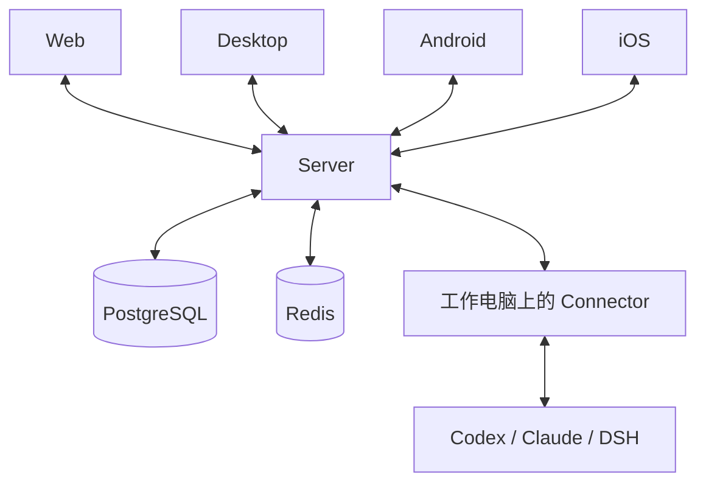

# 多端同步解密：电脑发出的消息，手机怎样看到；断网以后又怎样追上

你在电脑上让 AI 修复一个问题，然后拿起手机。手机上能看到同一条回答正在往外写，也能点停止、处理审批。

接着你进了电梯，手机断网。出来以后，刚才没收到的内容又补回来了。

还有另一种情况：工作电脑关机了，你在手机上把模型渠道从 A 改成 C。工作电脑明天开机，应该使用 C，而不是继续停在 A。

这两件事都叫“同步”，但做法不同。这篇文章分别走完它们的全过程：消息从哪里来、Redis 保存什么、PostgreSQL 保存什么、断网后谁发起恢复，以及程序怎样判断已经追上。

相关内容：[审批怎样恢复执行](01-审批架构：从LangGraph到Codex再到AA.md)、[Plan 正文怎样保存和批准](02-Plan模式：原生规划与版本化审批.md)、[目标怎样自动续跑](03-目标模式：持久状态与自动续跑.md)。

## 1. 四个屏幕看的是同一处执行

AA 的四端是 Web、Desktop、Android 和 iOS。登录同一账号、连接同一套 Server 后，它们可以查看同一会话。



模型任务主要由工作设备上的 Connector 和原生程序执行。四端是四个操作窗口，不是各运行一遍相同任务。

Desktop 可以管理本机 Connector，但手机查看这条会话时，仍要找到这条会话对应的 Connector 和原生程序。

如果 Server 部署了多个实例，它们就像多个服务窗口。手机可能连着窗口 A，电脑的 Connector 连着 B。它们需要共享数据、转发操作，但不能假定能直接访问对方内存。

## 2. 先分清两条更新通道

| 你看的位置 | 更新内容 | 通道怎样工作 |
| --- | --- | --- |
| 首页、侧栏 | 项目、会话列表、设备状态等 | Dashboard WebSocket，变化后重建并发送当前快照 |
| 会话详情 | 消息、回答、工具结果、执行状态和审批 | Session WebSocket，发送具体变化 |

WebSocket 是服务器可以主动发消息给客户端的长连接。它与普通 HTTP 请求的区别是：不用手机每隔一会儿问一次“有新消息吗”。

“快照”就是某一时刻的一份当前结果；“增量”就是此后变化的部分。

两条通道分开，意味着聊天正文已经更新，不代表侧栏必须在完全相同的时刻更新。首页还要重新计算列表，可能合并短时间内的多次变化。

## 3. 第一次打开会话，先拿到什么

客户端读取会话快照，取得会话信息、当前加载的消息窗口和事件游标。较早历史可以另行分页，不要求一次下载全部聊天。

游标像书签，例如 `seq:120`，表示已经处理到这一进度。它不等于“第 120 条聊天”：同一条流式回答更新多次，也会产生新进度。

接下来客户端订阅这个会话的实时更新。Server 会检查 WebSocket ticket，确认这张短期通行证属于相应会话，再验证账号确实拥有它。

Server 将这条连接的发送队列登记到会话订阅表后，才发送 `session.subscribed`。

```text
校验连接身份
  → 登记 session-a 的订阅队列
  → 返回 session.subscribed
  → 开始转发该会话事件
```

收到“已订阅”，才说明 Server 已经把你加入分发名单。连接刚打开，不等于这个步骤已经完成。

[会话订阅入口](https://github.com/anywhere-labs/Agents-Anywhere/blob/1f827133d6d6de86df424898d9b9738b6b3aebf3/server/agent_server/api/sessions.py)。

## 4. 读取快照和订阅之间，会不会漏消息

如果先读快照，随后才订阅，中间刚好产生一条回答，会发生什么？

```text
快照读到 seq:120
此时出现 seq:121
订阅才建立
```

不能只指望从此以后的 WebSocket 消息把 121 补回来。

AA 的 Web 实现会等快照准备好、收到 session.subscribed 后，再从已保存游标发起恢复请求。快照没准备好或正在恢复时，实时事件暂存在客户端缓冲区，避免与恢复结果互相覆盖。

```text
拿到快照和游标
  +
确认实时订阅已登记
  ↓
从已有游标补查一次
  ↓
合并补查结果和收到的实时事件
```

这里以 Web 代码说明具体配合方式；四端共享服务端协议，不代表四种客户端用了同一段连接代码。[Web 的订阅与补查](https://github.com/anywhere-labs/Agents-Anywhere/blob/1f827133d6d6de86df424898d9b9738b6b3aebf3/web-next/src/components/session-detail.tsx)。

## 5. 电脑发送任务，Server 怎样找到工作设备

Desktop 将消息发送给 Server。Server 根据会话记录，知道 connector_id、runtime_id 和原生会话编号。

如果 Connector 就连在本实例，Server 可以通过已有 WebSocket 发 RPC。RPC 可以理解成“请工作电脑做一件事，然后回结果”。

如果 Connector 连在另一个实例，则先查 Redis：

```text
键：agents-anywhere:connector:presence:device1
类型：String
内容：{"instanceId":"server-b","connectionId":"conn-7","ready":true}
```

这条记录带有效期，Connector 心跳负责续期，表示 B 目前拥有 conn-7 这条连接。

Server A 随后把请求发布到 B 的 RPC 频道：

```text
agents-anywhere:channel:connector-rpc:server-b
```

A 在内存里登记一个等待回执的 Future，也就是“等待装入结果的盒子”。B 验证连接身份，再把操作送往 Connector，最后把结果沿原路返回 A。

接着 Connector 驱动对应原生程序，模型才开始工作。**这次发送请求的回执，和模型后续回答，是两条不同的信息流。**

[连接租约和跨实例 RPC](https://github.com/anywhere-labs/Agents-Anywhere/blob/1f827133d6d6de86df424898d9b9738b6b3aebf3/server/agent_server/infra/connector_rpc.py)。

## 6. 回答写了一半，Server 收到的是怎样的数据

原生程序输出消息和工具事件，Connector 将它们转换为 Timeline 条目。“Timeline”就是会话里按顺序呈现的消息、工具活动等内容。

每个条目都有稳定 ID。假设回答编号是 answer-5：

| 时刻 | ID | 内容 |
| --- | --- | --- |
| 刚开始 | answer-5 | 正在检查 |
| 一会儿后 | answer-5 | 正在检查登录接口 |
| 完成 | answer-5 | 已定位问题，修改如下…… |

这是同一个条目不断更新，不是每段文字都新增一个气泡。

条目还有两个容易混淆的序号：

| 字段 | 用途 |
| --- | --- |
| orderSeq | 这个条目在时间线中的位置 |
| updatedSeq | 这份条目内容最近一次更新的进度 |

同一个回答位置不变，updatedSeq 可以不断增大。客户端按 ID 更新原条目，而不是简单把每个网络包追加到页面底部。

## 7. PostgreSQL 最后保存的是哪张表、哪一行

聊天内容主要进入 `timeline_items`：

| 列 | 保存什么 |
| --- | --- |
| session_id + id | 两列共同确定一个条目 |
| type / status / role | 类型、状态、角色 |
| order_seq | 展示位置 |
| updated_seq | 最新更新进度 |
| item_time | 条目时间 |
| payload_json | 完整条目，保存成 JSON 文本 |

例如：

| session_id | id | order_seq | updated_seq | payload_json 的含义 |
| --- | --- | --- | --- | --- |
| session-a | answer-5 | 8 | 123 | 回答到“正在检查” |
| session-a | tool-6 | 9 | 124 | 工具开始运行 |

answer-5 后来更新到 127，会更新同一行，不会再增加一个 answer-5。

数据库使用插入或更新，冲突身份是 session_id + id，并检查传入 updated_seq 不旧于数据库记录。迟到的 123 不能覆盖已经保存的 127。

会话本身在 `sessions`，保存 Connector、Runtime、标题等信息，也保存 seq、seq_allocated_high、timeline_reset_seq 等同步进度。

[表结构](https://github.com/anywhere-labs/Agents-Anywhere/blob/1f827133d6d6de86df424898d9b9738b6b3aebf3/server/agent_server/infra/db/schema.py)、[条目更新](https://github.com/anywhere-labs/Agents-Anywhere/blob/1f827133d6d6de86df424898d9b9738b6b3aebf3/server/agent_server/infra/timeline_store.py)。

## 8. 为什么手机能在 PostgreSQL 写完之前看到回答

流式回答更新很密。如果每一点变化都同步写 PostgreSQL、等提交，再显示，开销会很大。

AA 的分布式部署先保留待写入状态，再广播，随后合并写入 PostgreSQL：

```text
接收一个条目更新
  → 校验并确定稳定身份
  → 分配 updatedSeq
  → 保存 Redis 待写入内容
  → 广播实时更新
  → 手机显示
  → 后台合并写 PostgreSQL
```

因此手机看到回答时，数据库里可能还是该回答的较早版本。此刻较新的完整条目保存在 Redis 待写区。

这不是“广播完就不管”。后续可靠读取要把待写内容刷进数据库；后台也会持续刷写。

[接收、暂存与广播顺序](https://github.com/anywhere-labs/Agents-Anywhere/blob/1f827133d6d6de86df424898d9b9738b6b3aebf3/server/agent_server/services/timeline_write_buffer.py)。

## 9. Redis 待写区具体长什么样

默认前缀下，主要有：

| 键 | 类型 | 内容 |
| --- | --- | --- |
| `agents-anywhere:timeline-buffer:session-a:items` | Hash | 条目 ID → 完整条目 JSON |
| `agents-anywhere:timeline-buffer:session-a:source` | String | 来源观察时间 |
| `agents-anywhere:timeline-buffer:session-a:mark-read` | String | 是否需要标记已读 |
| `agents-anywhere:timeline-buffer:dirty` | Set | 哪些会话有内容待处理 |

Hash 像一个小字典。例如：

```text
answer-5 → {"id":"answer-5", "updatedSeq":127, ...完整条目...}
tool-6   → {"id":"tool-6", "updatedSeq":126, ...完整条目...}
```

answer-5 连续更新到 123、125、127，待写区可以只保留最新的 127。这是“合并写入”，不是保存每次打字的录像。

dirty 集合让后台知道哪些会话需要刷写，不用每次扫描所有会话。

这些待写键没有普通缓存那样的到期自动删除。部署使用 AOF、持久卷和 noeviction，目的是避免尚未进入 PostgreSQL 的内容被随意淘汰。AOF everysec 仍存在最近尚未同步到磁盘的丢失窗口，不能把“Redis 已接收”说成“绝不会丢”。

不配置 Redis 的单进程模式，待写内容放在进程内存，崩溃后更无法从别的实例接手。

[待写区结构与清理](https://github.com/anywhere-labs/Agents-Anywhere/blob/1f827133d6d6de86df424898d9b9738b6b3aebf3/server/agent_server/services/timeline_write_buffer.py)、[持久性边界](https://github.com/anywhere-labs/Agents-Anywhere/blob/1f827133d6d6de86df424898d9b9738b6b3aebf3/docs/server-architecture.md)。

## 10. 进度号怎样保证不同 Server 不乱发

不能让 A 和 B 都凭自己的内存说：“下一个编号是 121。”

AA 先从 PostgreSQL 为会话申请一段可用编号。数据库在事务中推进 `sessions.seq_allocated_high`，默认一批可以预留 4096 个。Redis 再在这段范围内快速递增分配。

| Redis 键的末段 | 作用 |
| --- | --- |
| `session-revision:{sessionId}:head` | 当前已分配到哪里 |
| `session-revision:{sessionId}:lease-end` | 本批允许用到哪里 |
| `session-revision:{sessionId}:lease-epoch` | 对应哪次 Redis 进程身份 |
| `session-revision:{sessionId}:published` | 已确认发布到哪里 |

这些键前面同样有默认的 agents-anywhere 前缀。

预留编号不等于聊天已经落库。`seq_allocated_high` 是“发号上限”，`sessions.seq` 是持久状态公开到的进度。

如果 Redis 重启，数据库还记得以前分配过的上限。重新申请时可以跳过未使用号码，避免旧号码被再次使用。**允许跳号，因此客户端不能只因 120 后出现 125 就断定漏了四条聊天。**

[编号分配器](https://github.com/anywhere-labs/Agents-Anywhere/blob/1f827133d6d6de86df424898d9b9738b6b3aebf3/server/agent_server/services/session_revision_allocator.py)、[PostgreSQL 预留](https://github.com/anywhere-labs/Agents-Anywhere/blob/1f827133d6d6de86df424898d9b9738b6b3aebf3/server/agent_server/infra/repositories/timeline.py)。

## 11. 广播怎样到达连在其他 Server 上的手机

TimelineBroker 是负责分发的人。它在每个 Server 内存里保存：

```text
session-a → {连接甲的发送队列, 连接乙的发送队列, ...}
```

分布式部署还订阅 Redis 的 Timeline 频道：

```text
agents-anywhere:channel:timeline:session-a
```

任一实例接收更新后，发布包含 sessionId、nextSeq 和 items 的信封。其他实例收到，就把信封分发到自己这边订阅 session-a 的队列。每条 WebSocket 的发送任务再从队列取出消息，编码为协议事件，发给客户端。

```text
Runtime → Connector → Server B
  → Redis Timeline 频道
  → Server A 的订阅监听
  → session-a 的本地发送队列
  → 手机 WebSocket
  → 按条目 ID 更新页面
```

这条 Pub/Sub 是实时广播，不是存档。超过大小限制的信封也可以换成“需要重新读取”的提示，而不是把巨大正文继续塞入全局广播。

如果 Redis 订阅失效，Broker 会发出恢复信号，WebSocket 连接进入断开与重连恢复流程，避免悄悄漏消息却继续声称连接正常。

[广播、队列与失联信号](https://github.com/anywhere-labs/Agents-Anywhere/blob/1f827133d6d6de86df424898d9b9738b6b3aebf3/server/agent_server/infra/timeline_broker.py)。

## 12. 后台怎样把 Redis 内容变成 PostgreSQL 行

后台刷写进入会话级保护，读取待写区的一份快照，然后调用 `persist_buffered_timeline_items()`。

数据库事务会检查：

- 该条目是否比已有版本更新。
- 这份待写内容是否早于某次全量重置，已经不该再出现。
- 是否需要更新会话进度和相关元数据。

提交成功后，再清理 Redis 中已经处理的内容。

清理不是直接把整个 Hash 删掉。程序比较当前值是否仍等于刚才写入的快照；如果 answer-5 在刷写期间已经变成更新版本，就保留新版本。

```text
读取 answer-5 的 127
  → 写入 PostgreSQL
  → 清理前发现当前已经是 129
  → 不能删 129
```

已成功实时广播的普通更新，落库后不再重复广播一遍。需要修复进度或重排时，会发布重新读取提示。首页列表的失效通知则主要随落库发出。

## 13. 手机断线后，恢复接口怎样查数据库

手机上次处理到 seq:120，重连后发：

```text
GET /api/v2/sessions/session-a/events?after=seq:120
```

Server 先确认账号拥有该会话。若配置了写缓冲，会进入 `session_fence()`，把当前可见待写内容先刷入 PostgreSQL，再进行恢复读取。这像先让账本把未入账的收据记完，再回答“你漏看了什么”。

接着 EventRecoveryService：

1. 读取当前会话进度。
2. 检查客户端游标有没有跑到服务器前面。
3. 检查该游标是否早于时间线重置位置。
4. 查询 updated_seq 大于 120 的条目。
5. 再读一次当前进度，确认读取期间没有变化。
6. 必要时重试稳定读取，成功后组装协议事件。

概念查询如下：

```sql
SELECT payload_json
FROM timeline_items
WHERE session_id = :session
  AND updated_seq > :after_seq
ORDER BY updated_seq;
```

恢复返回的是条目的当前版本。answer-5 如果从 123 一路变到 129，断线手机通常直接拿最新版本，不会重新播放所有中间字。

[恢复服务](https://github.com/anywhere-labs/Agents-Anywhere/blob/1f827133d6d6de86df424898d9b9738b6b3aebf3/server/agent_server/services/event_recovery.py)、[待写区读取屏障](https://github.com/anywhere-labs/Agents-Anywhere/blob/1f827133d6d6de86df424898d9b9738b6b3aebf3/server/agent_server/services/timeline_write_buffer.py)。

## 14. 什么时候不补小块，直接重新拿快照

恢复服务会返回 `snapshotRequired=true` 的情况包括：

| 情况 | 为什么不能照旧补 |
| --- | --- |
| 客户端游标大于服务器当前值 | 这个书签不能直接作为有效起点 |
| 游标早于时间线重置位置 | 有些旧条目可能被移除，仅更新几行不能恢复正确结果 |
| 超出一次恢复条目上限 | 当前实现要求换快照，而非无限补事件 |
| 多次读取都不稳定 | 无法得到可靠的一批恢复结果 |

默认恢复上限是 500，稳定读取尝试为 3 次。这些是服务默认值，不是“聊天最多 500 条”。

客户端拿到快照后，替换相应当前状态、更新游标，再继续消费实时事件。

所以恢复过程不是“永远从事件表里一条条回放”。这里主要从当前持久条目重新生成变化，必要时直接重读快照。

## 15. 历史追回来了，审批为什么还要重新问原生

历史回答存在 PostgreSQL。正在运行、等待审批、当前问题能不能回答，属于原生程序的当前事实。

`/events` 不会给你恢复一个已经消失的原生 Future。Web 在补历史之后，还会查询当前 Runtime 状态和适用的能力；审批则通过 notices 的拉取与实时变化更新。

```text
历史补齐：数据库回答“保存了什么”
实时校准：原生程序回答“现在还能做什么”
```

手机断网期间，如果电脑已经处理完审批，重连后不能只因旧气泡还在，就继续显示一个有效的批准按钮。审批篇详细解释了原生等待的位置。

## 16. 首页为什么重发整份列表

Dashboard WebSocket 连接时登记账号的订阅队列，并发送一份当前列表快照。

会话变化引发 dashboard.changed 通知后，发送任务会合并排队通知，只保留最新的刷新需求，然后重新构建快照。

```text
收到一批变化通知
  → 合并“需要刷新”这个事实
  → 查当前列表和设备情况
  → 生成新快照
  → 发给客户端
```

它不是“每个 token 都重新下载全部聊天”，也不是在客户端靠几百条微小差异拼侧栏。

客户端看到的设备在线状态，也不能只读 PostgreSQL 的 last_seen_at。当前连接与 Redis 租约才能说明谁现在真正在线。

[Dashboard 连接与快照发送](https://github.com/anywhere-labs/Agents-Anywhere/blob/1f827133d6d6de86df424898d9b9738b6b3aebf3/server/agent_server/api/dashboard_stream.py)。

## 17. 另一件事：工作电脑关机时，手机改渠道

下面讲的是渠道追赶的开发实现；这部分还没有进入 main，和前面的已有聊天同步机制分开理解。

假设 device1 上的 codex 当前使用 A，第 9 代配置。电脑离线时，用户最终把目标改为 C，第 12 代。

这里不能靠重放聊天事件解决。需要一份长期记录说明“设备应该变成什么”和“实际到了哪里”。

几张表分别承担这些工作：

| 表 | 一行代表什么 | 关键列 |
| --- | --- | --- |
| model_channel_selections | 一个用户的默认选择 | user_id、channel、revision |
| runtime_channel_overrides | 一个 Runtime 的例外选择 | connector_id、runtime_id、channel |
| model_profiles | 一份真实模型连接配置 | id、offers_json、secret_ciphertext、key_ref_json、connection_revision |
| runtime_channel_sync | 一个 Runtime 的目标和追赶进度 | desired_generation、desired_channel、applied_generation、actual_channel 等 |
| runtime_channel_switches | 这个 Runtime 当前的切换过程 | state、step、目标代数、加密快照、执行租约等 |
| channel_sync_outbox | 一次需要被处理的设备通知 | connector_id、投递时间、重试与认领信息 |

JSON 文本负责复杂内容，常用的查找和比较字段分列。密钥有加密字段或引用，不能当作普通渠道名广播给四端。

[开发实现的表结构](https://github.com/anywhere-labs/Agents-Anywhere/blob/5e39643d80dd8c3b0f69f5e52e64abdd15df1781/server/agent_server/infra/db/schema.py)。

## 18. 修改渠道时，目标行和通知怎样一起保存

程序先确定该 Runtime 是跟随用户默认，还是有单独例外。然后读取对应 profile，计算目标配置摘要。

这个摘要不只看 channel 名，还考虑连接版本、模型目录摘要等相关材料。渠道仍叫 C，连接内容变化，也可能需要产生新目标。

在 PostgreSQL 事务中：

```text
确定用户及 Runtime 的有效目标
  → 没有同步行：插入第 1 代
  → 有同步行且摘要不同：目标代数加 1，更新目标
  → 摘要相同：不凭空增加一代
  → 为发生变化的设备插入 outbox 通知
  → 一起提交
```

数据库里的例子：

| connector_id | runtime_id | desired_channel | desired_generation | actual_channel | applied_generation |
| --- | --- | --- | --- | --- | --- |
| device1 | codex | mpr_C | 12 | mpr_A | 9 |

12 与 9 不同，就还没有追上。设备离线时可以继续修改同一行的目标，实际代数保留。

查找未追上记录可以用：

```sql
SELECT *
FROM runtime_channel_sync
WHERE connector_id = 'device1'
  AND applied_generation IS DISTINCT FROM desired_generation;
```

`IS DISTINCT FROM` 还能找出 applied_generation 为 NULL、一次都没应用过的记录。

目标和通知在同一事务里，可以避免“目标写好了，程序立刻崩溃，忘了安排后续处理”。[目标更新与 outbox 写入](https://github.com/anywhere-labs/Agents-Anywhere/blob/5e39643d80dd8c3b0f69f5e52e64abdd15df1781/server/agent_server/infra/repositories/channel_reconciliation.py)。

## 19. 数据库不会自己醒：后台程序怎样发现要做事

Server 启动 ChannelReconciler 后，会运行通知投递、补偿扫描，以及配置 Redis 时的订阅监听。

投递程序不断查询 outbox，挑选：未 delivered、已经到尝试时间、没有有效认领者的记录。数据库用行锁和 SKIP LOCKED 避免多个处理者一起认领同一批，随后写 claim_owner、claim_until 和尝试次数。

拿到一条通知后：

```text
发布 Redis 唤醒消息
  +
本实例也直接调用规划检查
  ↓
规划器读 PostgreSQL 最新目标
  ↓
安排该设备的 Runtime 追赶
```

实际唤醒 topic 是：

```text
agents-anywhere:channel-sync-wake
```

通知内容包含 userId 和 connectorId，不承担完整配置存档。

投递成功只代表通知处理完成，**不代表设备已经切换成功**。设备若离线，目标仍留在数据库里。

另外的补偿程序会查询需要追赶的设备，周期性重新检查。它让一次丢失的 Pub/Sub 通知不至于永久卡住同步。

[通知循环、订阅与补偿](https://github.com/anywhere-labs/Agents-Anywhere/blob/5e39643d80dd8c3b0f69f5e52e64abdd15df1781/server/agent_server/services/channel_reconciliation.py)。

## 20. Redis 的渠道等待记录究竟保存什么

开发实现的等待记录是 Hash：

```text
键：agents-anywhere:channel-wait:device1
字段：codex
值：{"user":"user1","generation":12}
```

它比“codex → user1”多了目标代数。写入会比较代数，避免旧工作覆盖新等待；清除时也会比较，避免第 11 代任务清掉第 12 代标记。

这是一份方便快速定位的记录，不是目标配置的唯一来源。完整目标、实际代数和错误状态仍在 PostgreSQL。

设备上线或补偿扫描进入规划器时，应重新读取最新目标。若离线时先改 B、后改 C，需要追赶最终的 C，不是按旧通知逐个切回历史配置。

[等待 Hash 与代数检查](https://github.com/anywhere-labs/Agents-Anywhere/blob/5e39643d80dd8c3b0f69f5e52e64abdd15df1781/server/agent_server/services/model_channels.py)。

## 21. 设备上线后，怎样确认真的切到了 C

执行者先取得切换租约，带 owner 和 epoch，防止旧执行者在租约失效后随意写结果。切换过程记录在 runtime_channel_switches。

后面的关键步骤是：

```text
读取最新目标和当前原生配置
  → 准备切换方案与恢复快照
  → 按条件等待设备可用、排空受影响执行
  → 再核对目标代数
  → 将目标配置送到 Connector
  → 更新或重启对应 Runtime
  → 读取它实际运行的配置
  → 比较配置摘要和运行状态
  → 成功后更新实际状态与已应用代数
```

不是配置写进文件就算成功。当前实现会查看 Runtime 是否运行、配置摘要是否符合预期，以及连接状态有没有明确失败。

验证通过后，事务更新 actual_channel、actual_config_digest、applied_generation、观察到的实例等，并将切换过程收尾为 applied，再发布账号更新。

```text
原来：desired=12，applied=9
成功：desired=12，applied=12
```

如果执行第 12 代时用户又改成第 13 代，不能拿第 12 代成功证明已经追上最新目标。比较与后续重新规划仍然必要。

这里的 applied 只说明 Runtime 采用了相应配置，不证明模型上游真实请求一定成功。两者需要不同证据。[切换、核实和提交](https://github.com/anywhere-labs/Agents-Anywhere/blob/5e39643d80dd8c3b0f69f5e52e64abdd15df1781/server/agent_server/services/model_channels.py)。

## 22. 超时或失败，为什么不能直接写“已同步”

写配置的 RPC 超时，可能是设备没收到，也可能是已经启动但回执没回来。程序会重新查询原生实际配置，而不是只信超时或旧内存结果。

数据库还保存 retry_count、next_retry_at、last_error_code 等，供后续重试和界面解释。切换快照与过程记录也用于判断恢复路径。

这和聊天恢复有个共同点：**缺一条网络消息，不等于事情没有发生；补偿必须重新查询事实。**

查看结果时，需要同时看目标代数、实际代数和错误状态，不能只看通知有没有送达。

## 23. 哪些东西本来就没有跨设备同步

共享会话不等于共享整个页面内存。

| 内容 | 以谁为准 |
| --- | --- |
| 已保存聊天和会话信息 | Server 的持久数据 |
| 尚未落库的新 Timeline 版本 | 共享待写区和后续落库过程 |
| 当前审批还能不能回答 | 原生程序当前有效交互 |
| 设备现在在线吗 | 活连接和租约 |
| Web 输入框里还没发送的草稿 | Web 本地存储 |
| 页面展开、阅读位置等 | 各功能自己的客户端状态或专门存储 |

Web 的输入草稿存在 localStorage，不会因为登录同一账号，就自动出现在手机输入框。

两端同时发消息，也不能凭界面还显示“可发送”就认定操作一定有效。最后要由 Server、Connector 和原生执行入口判断；不同操作的去重与并发规则不同，不存在一个覆盖全部动作的“绝对只执行一次”开关。

## 24. 把两种追赶放在一起看

```text
手机漏看聊天：
  旧游标 → 重连订阅 → 刷待写数据 → 查更新条目
  → 必要时重拉快照 → 校准原生实时状态

工作电脑漏用新配置：
  最新目标已存数据库 → outbox 与扫描发现工作
  → 等设备可用 → 应用最新配置 → 读取实际配置
  → 更新已应用代数
```

前一种是在补“我还没看到的内容”；后一种是在做“这台设备还没做到的改变”。

它们都不能只靠实时广播。实时消息负责让事情尽快发生；保存的数据和恢复程序，负责在断线、重启或漏通知以后，重新找到应该做的事。
