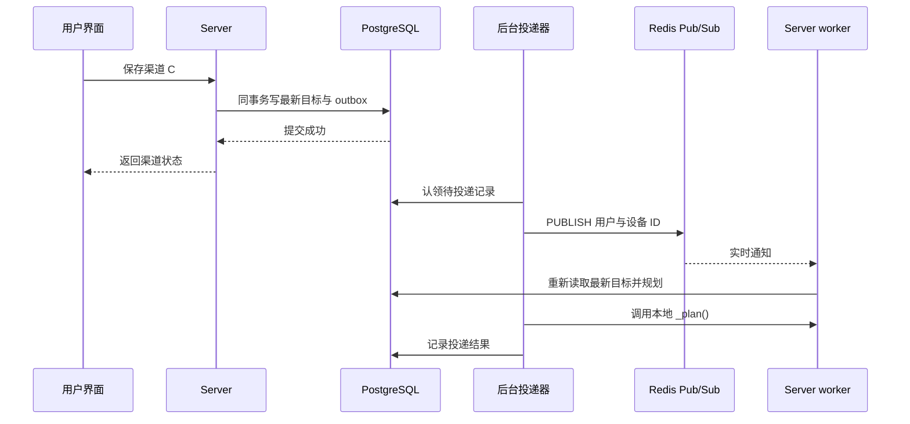

# Agents Anywhere 离线追赶架构揭秘：Redis 怎么存、怎么取

设备离线时，用户把模型渠道从 A 切到 B，再切到 C。设备重新上线，需要直接应用 C。实现这件事，要同时解决两个问题：保存用户最后的选择，以及让负责这台设备的 Server 尽快开始处理。

AA 把最新目标保存在 PostgreSQL，把 Redis 用作待处理索引、执行竞争优化和跨进程唤醒。本文重点拆开 Redis 中的数据结构与读写过程。

本文核对于 2026-11-04，源码基线为 `5e39643d80dd8c3b0f69f5e52e64abdd15df1781`。以下“当前实现”指该提交的本地源码；“退出 Anywhere”的持久化流程在文末单独作为设计扩展说明。这里只做源码说明，没有运行服务或读取真实 Redis 数据。

## 1. 先看 Redis 中到底有什么

与渠道追赶直接相关的 Redis 对象主要有三类：

| 对象 | Redis 类型 | 名称模板 | 内容 | 生命周期 |
| --- | --- | --- | --- | --- |
| 设备待处理索引 | Hash | `<prefix>:channel-wait:<connectorId>` | field 为 Runtime ID，value 为用户与目标代次的 JSON | 当前写入未设置 TTL，按处理结果删除 field |
| Runtime 执行短租约 | String | `<prefix>:channel-drive:<connectorId>:<runtimeId>` | 本次执行者的随机 owner token | 60 秒 TTL，执行期间约每 15 秒尝试续期 |
| 跨进程唤醒频道 | Pub/Sub channel | `<prefix>:channel-sync-wake` | 用户与设备 ID 的通知 JSON | 消息即时发送，没有可供事后读取的历史 |

`RedisCoordinator.key()` 用冒号拼接各段，默认前缀为 `agents-anywhere`，部署时可以配置其他前缀。下文使用默认值与虚构 ID：

```text
用户：u_01
设备：con_laptop
逻辑 Runtime：codex
最新目标代次：12
```

对应的布局为：

```text
Redis keyspace
├── agents-anywhere:channel-wait:con_laptop        [Hash]
│   ├── codex  → {"user":"u_01","generation":12}
│   └── claude → {"user":"u_01","generation":7}
└── agents-anywhere:channel-drive:con_laptop:codex [String]
    └── 随机 owner token，TTL 60 秒

Redis Pub/Sub
└── agents-anywhere:channel-sync-wake             [频道，不是数据 key]
    └── {"userId":"u_01","connectorId":"con_laptop"}
```

这三类对象都不保存目标渠道的完整连接配置或 API Key。`generation: 12` 也不能单独解释出“应该使用渠道 C”，它只是代次标记。真正的渠道、目标摘要与实际应用代次需要查 PostgreSQL。

## 2. 待处理索引：一个设备一个 Hash

### 2.1 为什么以设备为 key、Runtime 为 field

一台设备可能同时提供 Codex、Claude 等 Runtime。设备级 Hash 可以同时支持两种访问：

- 某个 Runtime 发生事件：按 field 精确读取。
- 查看这台设备所有待处理标记：一次读取整个 Hash。

不需要为每次渠道变化新增一条历史命令。同一 Runtime 的标记只保留一个 value，后续代次可以覆盖前面的代次。

### 2.2 怎么存：`ChannelWakeIndex.mark()`

业务调用形如：

```python
await wake.mark("con_laptop", "codex", "u_01", generation=12)
```

其结果可以理解为：

```redis
HSET agents-anywhere:channel-wait:con_laptop codex '{"user":"u_01","generation":12}'
```

但源码使用 Lua，把“读取旧代次、比较、写入”合为一次原子操作。以下为省略兼容解析后的核心逻辑示意：

```lua
-- KEYS[1]：设备 Hash key
-- ARGV[1]：Runtime ID
-- ARGV[2]：用户 ID
-- ARGV[3]：本次 generation
local old = redis.call('HGET', KEYS[1], ARGV[1])
local version = 0
if old then
    version = cjson.decode(old).generation or 0
end
if version <= tonumber(ARGV[3]) then
    redis.call('HSET', KEYS[1], ARGV[1], cjson.encode({
        user = ARGV[2], generation = tonumber(ARGV[3])
    }))
end
```

例如 Redis 已经保存 `generation=12`，迟到的 `generation=11` 标记不能把它覆盖回去；重复写入 12 则允许。

如果在应用进程中分成 `HGET → 比较 → HSET` 三步，两个 worker 的请求可能交错。Lua 将判断与更新放在 Redis 内执行，避免这个窗口。

注意：当前 `mark()` 的 generation 默认值是 `0`，部分等待、恢复路径没有显式传入代次。因此 Hash 中可能看到 0，也可能保留已有的更高代次；不能要求它在每个时刻都精确反映数据库的最新 generation。

### 2.3 怎么取：单个 Runtime 用 `HGET`

`ChannelWakeIndex.waiting()` 执行：

```redis
HGET agents-anywhere:channel-wait:con_laptop codex
```

得到的字符串再经 `_parse_wait()` 解析，返回：

```python
("codex", "u_01")
```

这里有个容易忽略的细节：**读取结果没有携带 generation，也没有携带渠道配置。** 这次读取只告诉调度器“唤醒哪个 Runtime、以哪个用户身份处理”；执行器随后重新从数据库读取目标。

当前 `runtime_event()` 的调用链为：

```text
Runtime 发生事件
  → waiting(connectorId, runtimeId)
  → HGET + _parse_wait()
  → _spawn(connectorId, runtimeId, userId)
  → 执行器读取 PostgreSQL 中的最新目标与进度
```

读取不会弹出或删除 field。这与 `LPOP` 消费队列不同，同一个标记可以多次触发调度，执行竞争由后面的租约处理。

### 2.4 怎么取一台设备的全部标记：`HGETALL`

`on_connector_raw()` 和 `on_connector()` 都使用：

```redis
HGETALL agents-anywhere:channel-wait:con_laptop
```

两者的返回组织方式不同：前者保留原始 field 到唤醒对象的映射；后者按解析后的 Runtime 组织结果。解析器还兼容旧的纯用户字符串，以及 `userId<TAB>servedRuntimeId` 形式的别名值。

**这些批量读取方法的存在，不代表设备上线仍依赖 Hash 枚举。** 当前 `connector_event()` 会查设备所属用户，刷新 PostgreSQL 目标，再按设备执行 `_plan(..., reconnect=True)`。即使 `HGETALL` 为空，上线对账仍有数据库入口。

### 2.5 怎么删：按代次保护的 `HDEL`

完成处理时，`clear(connectorId, runtimeId, generation)` 使用 Lua 检查：

```text
Hash field 不存在 → 无需删除
Hash 中代次 > 本次清理代次 → 保留
否则 → HDEL 指定 Runtime field
```

例如旧操作 11 的完成回执晚到了，但 Redis 中已经是 12，清理 11 不会删掉 12 的标记。这与写入时的版本比较共同保护较新的唤醒索引。

当前 Redis 路径在未传 generation 时使用 `-1` 作比较；带正代次的 JSON 标记不会被这种清理删除。阅读调用点时应核对参数，不能把 `clear()` 理解为无条件 `DEL`。

Hash 没有在 `mark()` 中设置 TTL。正常清理按 field 进行，最后一个 field 删除后 Hash 随之消失。标记残留也不能作为“设备一定还没同步”的证据，最终要核对数据库进度与设备观测结果。

## 3. 执行租约：一个 Runtime 一个 String

同一条通知可能被多个 Server worker 收到。`ChannelDriver` 分三层约束执行：进程内任务去重、Redis 短租约、PostgreSQL 执行租约与 epoch。

### 3.1 怎么抢：`SET NX PX`

worker 为本次执行生成随机 owner token，调用 `RedisCoordinator.claim()`：

```redis
SET agents-anywhere:channel-drive:con_laptop:codex owner_A NX PX 60000
```

这里的 `owner_A` 只是便于说明的占位值。

| 结果 | 含义 | 当前处理 |
| --- | --- | --- |
| 写入成功 | 当前没有这个租约 key | 继续申请 PostgreSQL 执行资格 |
| 写入失败 | 已有 worker 占用 | 本次调度返回，后续事件或补偿可再次尝试 |
| Redis 抛出连接等错误 | 缓存竞争层不可用 | 跳过 Redis 租约，继续申请 PostgreSQL 执行资格 |

抢到 Redis key 后还必须取得数据库的 `lease_owner`、`lease_epoch` 等执行资格。Redis key 只是减少竞争；数据库写入还会校验当前执行者和租约。

### 3.2 怎么续：检查 owner 后 `PEXPIRE`

执行期间约每 15 秒调用 `refresh_if_value()`，其核心语义是：

```lua
if redis.call('GET', KEYS[1]) ~= ARGV[1] then
    return 0
end
redis.call('PEXPIRE', KEYS[1], 60000)
return 1
```

只有仍持有相同 token 的执行者可以续期。数据库租约也会续期，数据库续期失败会取消当前执行任务。

### 3.3 怎么释放：检查 owner 后 `DEL`

结束时使用 `delete_if_value()`，同样在 Lua 中完成 token 比较与删除。

考虑这个时间顺序：A 卡顿超过 TTL，租约过期；B 抢到同名 key；A 恢复后执行清理。若 A 直接 `DEL`，就会删掉 B 的租约。检查 value 仍为 `owner_A` 后再删，可以避免这个问题。

这也解释了为什么 String 的 value 必须是每次执行的独立 token，只存固定的 `1` 无法区分新旧持有者。

## 4. 跨进程唤醒：`PUBLISH` 发通知，`SUBSCRIBE` 接通知

### 4.1 发出的消息存在哪里

先看发布动作：

```redis
PUBLISH agents-anywhere:channel-sync-wake '{"userId":"u_01","connectorId":"con_laptop"}'
```

这里的 `channel-sync-wake` 是 Pub/Sub 频道，不能用 `GET`、`HGETALL` 取回刚才发布的消息，`SCAN` 也不会把它作为数据 key 列出。

Redis 官方将 Pub/Sub 描述为至多一次投递：订阅方断线或处理失败后，消息不会自动补发。因此 AA 用它通知“这台设备值得重新检查”，完整目标仍由数据库提供。[Redis Pub/Sub 投递语义](https://redis.io/docs/latest/develop/pubsub/#delivery-semantics)

### 4.2 怎么接收

`ChannelReconciler._listen()` 订阅频道：

```redis
SUBSCRIBE agents-anywhere:channel-sync-wake
```

收到消息后解析 JSON，调用：

```python
await channels._plan(body["userId"], connector=body["connectorId"])
```

消息没有 Runtime 列表、渠道、Key 或历史切换步骤。`_plan()` 重新查库，决定这台设备有哪些 Runtime 需要处理。即使收到的是旧通知，也会按当前数据库状态规划。

### 4.3 数据库提交后，进程在发布前退出怎么办

当前实现把目标更新与 `channel_sync_outbox` 通知记录放在同一个 PostgreSQL 事务中。后台 `_deliver()` 认领 outbox，发布 Redis 消息，并调用本地 `_plan()`；处理结果再写回 outbox。



outbox 投递完成不等于设备已经应用配置。订阅者仍可能错过消息，所以还需要上线对账与周期补偿。

当前补偿循环约每 5 秒扫描到期工作，约每 48～72 秒进行一次分页全量对账；这些是当前源码参数，不代表严格的完成时限。重试条件、设备连接与执行结果都会影响实际收敛时间。

## 5. 串起来：离线 A → B → C，怎么存、怎么取

假设设备已应用 A，对应 generation 10。下面展示正常规划路径的简化状态：

| 时间 | PostgreSQL 最新目标 | Redis Hash 的 codex field | 设备行为 |
| --- | --- | --- | --- |
| 设备离线 | A / 10，已应用 10 | 可能没有标记 | 无操作 |
| 用户选择 B | B / 11，已应用仍为 10 | `{"user":"u_01","generation":11}` | 离线等待 |
| 用户再选择 C | C / 12，已应用仍为 10 | 更新为 `{"user":"u_01","generation":12}` | 离线等待 |
| 设备上线 | 从数据库读取 C / 12 | 标记可存在，也可丢失 | 完成发现后对账，准备 C |
| 核实 C 已加载 | 已应用推进到 12 | 清理不高于 12 的标记 | 使用 C |

上线时的关键路径为：

```text
设备注册，建立发现阶段准入保护
  → Runtime 发现与活跃实例恢复
  → connector_discovered() 补齐最新目标
  → connector_event() 从 PostgreSQL 规划本设备工作
  → ChannelDriver 去重、申请租约
  → 读取最新目标、生成切换计划
  → Connector 应用并回报配置
  → 核实实际状态，推进 applied generation
  → 清理对应 Redis 标记
```

即使 Redis 中还残留 generation 11，执行器也不会据此应用 B。即使 Redis Hash 整个丢失，数据库仍保存 C，设备上线和后台补偿仍能找到工作。

离线期间产生的 outbox 通知可能有多条，但它们都指向“重新检查设备”。不会要求设备依次执行 B、C。追赶工作主要取决于最新目标与设备实际配置之间的差异，不随离线期间的选择次数线性增加。

## 6. PostgreSQL 只需记住这几件事

| 持久化对象 | 负责保存 |
| --- | --- |
| 全局渠道选择、Runtime 覆盖及模型配置 | 用户期望使用什么，单独指定优先于全局选择 |
| `runtime_channel_sync` | 最新目标代次、目标摘要、实际应用代次、观测与重试信息 |
| `runtime_channel_switches` | 正在执行哪一步、执行租约、加密恢复快照与计划 |
| `channel_sync_outbox` | 已提交目标需要触发的通知 |

概念上的 `desiredRevision / appliedRevision`，在当前对外状态中对应 `desiredGeneration / appliedGeneration`。它们与拒绝旧执行命令的 `switchRevision` 用途不同。

同渠道的 Key、地址或模型变化也会影响有效目标。当前目标摘要包含连接 revision、模型目录摘要、能力等材料；有效目标变化才推进 generation。Redis Hash 里的 generation 只是唤醒保护的一部分，设备侧还需要 `switchRevision` 防止迟到的停止、启动或恢复命令覆盖新操作。

## 7. 排查时，先看 Redis 的什么

以下命令使用前文虚构 ID，仅用于展示读取方式。实际环境应替换 key 前缀与 ID。

```bash
# 查看渠道追赶相关 key；Pub/Sub 频道不会作为 key 出现在结果中
redis-cli --scan --pattern 'agents-anywhere:channel-*'

# 查看设备待处理索引
redis-cli TYPE agents-anywhere:channel-wait:con_laptop
redis-cli HGETALL agents-anywhere:channel-wait:con_laptop
redis-cli HGET agents-anywhere:channel-wait:con_laptop codex
redis-cli TTL agents-anywhere:channel-wait:con_laptop

# 查看执行租约与剩余毫秒数
redis-cli GET agents-anywhere:channel-drive:con_laptop:codex
redis-cli PTTL agents-anywhere:channel-drive:con_laptop:codex

# 从现在开始观察实时唤醒，无法补看历史消息
redis-cli SUBSCRIBE agents-anywhere:channel-sync-wake
```

`TTL/PTTL` 返回 `-1` 表示 key 存在但未设过期时间，`-2` 表示 key 不存在。待处理 Hash 当前没有主动设置 TTL；执行 String 应有短 TTL。

| 观察结果 | 可以说明什么 | 下一步核对 |
| --- | --- | --- |
| Hash 没有 codex field | 当前没有这条 Redis 标记 | 数据库是否仍有未应用目标；上线对账是否执行 |
| Hash 代次落后数据库 | 索引可能滞后或来自默认代次路径 | 执行器实际读取的目标 generation |
| 执行 String 有值 | 有一个缓存租约尚未过期 | PostgreSQL 执行 owner、epoch、lease 与日志 |
| 收到 Pub/Sub 通知 | 此订阅者收到了这次唤醒 | 是否完成规划、设备应用与核实 |
| Pub/Sub 没有消息 | 观察期间未收到 | outbox、订阅状态与后台补偿 |

Redis 暂时不可用时，待处理索引读写有进程内回退，执行竞争可继续走数据库；这只说明渠道模块的降级路径，不代表 AA 所有依赖 Redis 的功能均可正常工作。Redis 正常返回“没有 field”时，`waiting()` 也不会再回退读取本地副本，可靠恢复仍依靠数据库入口。

## 8. 两个影响用户体验的边界

**配置已应用与模型请求成功分别判断。** 当前切换核实 Runtime 的启动状态与加载配置，不发送真实模型探针。`applied` 不能证明上游 Key、余额或模型服务一定可用。有效配置一致时避免重启；需要重新加载时，当前行为会中断运行中的任务，并非等待任务结束。

**离线追赶已经持久化，不等于退出 Anywhere 也已经持久化。** 当前 `tokens_link.unlink()` 仍会检查实际或期望渠道是否使用 Tokens，Web 的 `useTokensSignOut()` 仍在页面中等待再解绑。

若要实现“用户退出不等待离线设备”，需要额外的 Server 持久化退出操作：保存替代目标、记录退出与撤销进度、后台负责收尾，离线 Runtime 上线后再追赶。撤销结果未知时也要保留可恢复状态。

这项扩展还必须定义撤销后的失败规则：旧 Anywhere Key 已失效时，不能仅因旧配置重新加载成功，就把它当作可用回滚目标；同步完成前应阻止相关新任务。当前普通切换允许恢复成功后继续使用原渠道，这条规则不能直接套用于授权已撤销的场景。

## 9. 源码阅读入口

以下链接固定在本文核对的提交，便于按相同基线复核：

- [ChannelWakeIndex、ChannelDriver 与渠道状态机](https://github.com/congwa/Agents-Anywhere/blob/5e39643d80dd8c3b0f69f5e52e64abdd15df1781/server/agent_server/services/model_channels.py)：Hash 读写、代次清理、Runtime 事件与上线对账。
- [RedisCoordinator](https://github.com/congwa/Agents-Anywhere/blob/5e39643d80dd8c3b0f69f5e52e64abdd15df1781/server/agent_server/infra/redis_coordinator.py)：key 拼接、`SET NX PX`、带 token 校验的续期与删除。
- [ChannelReconciler](https://github.com/congwa/Agents-Anywhere/blob/5e39643d80dd8c3b0f69f5e52e64abdd15df1781/server/agent_server/services/channel_reconciliation.py)：outbox 投递、Pub/Sub 订阅与周期补偿。
- [持久化对账仓库](https://github.com/congwa/Agents-Anywhere/blob/5e39643d80dd8c3b0f69f5e52e64abdd15df1781/server/agent_server/infra/repositories/channel_reconciliation.py)：目标摘要、generation、执行租约与通知记录。
- [Connector switch fence](https://github.com/congwa/Agents-Anywhere/blob/5e39643d80dd8c3b0f69f5e52e64abdd15df1781/connector/connector/runtime_protocol/switch_fence.py)：设备侧防过期记录与配置摘要。
- [Tokens 解绑服务](https://github.com/congwa/Agents-Anywhere/blob/5e39643d80dd8c3b0f69f5e52e64abdd15df1781/server/agent_server/services/tokens_link.py)与 [Web 退出流程](https://github.com/congwa/Agents-Anywhere/blob/5e39643d80dd8c3b0f69f5e52e64abdd15df1781/web-next/src/components/settings/model-configs-tab.tsx)：区分当前退出行为与持久化退出设计。
