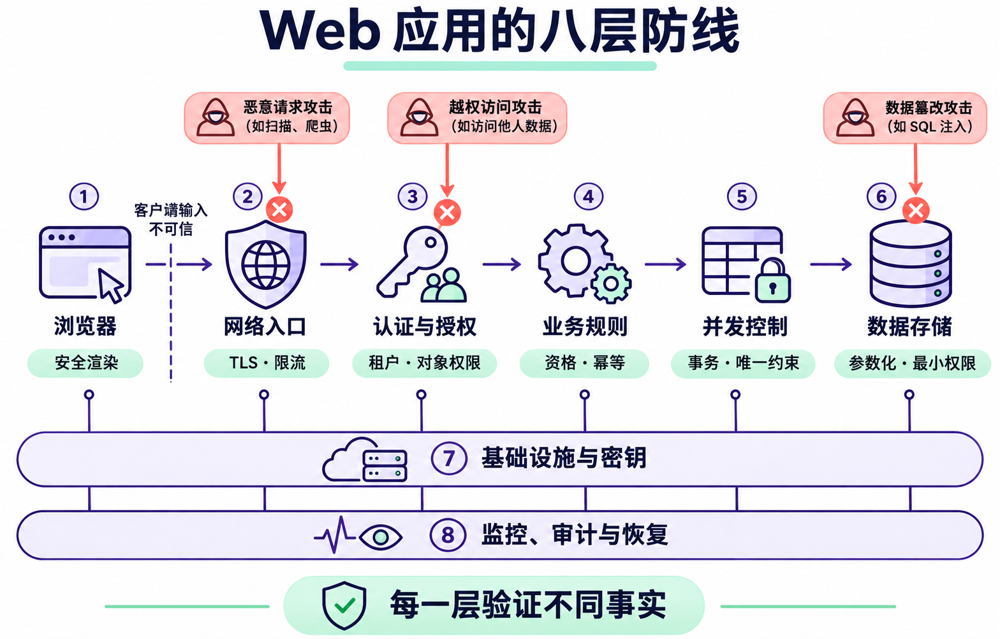
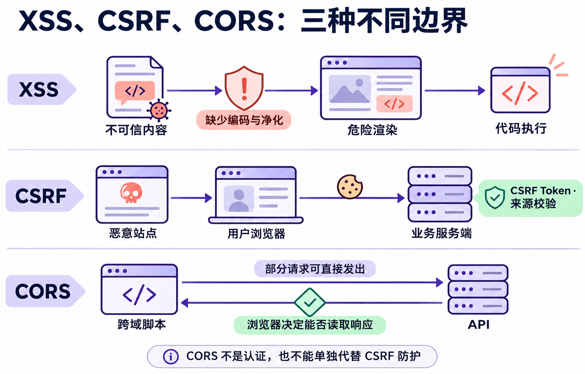
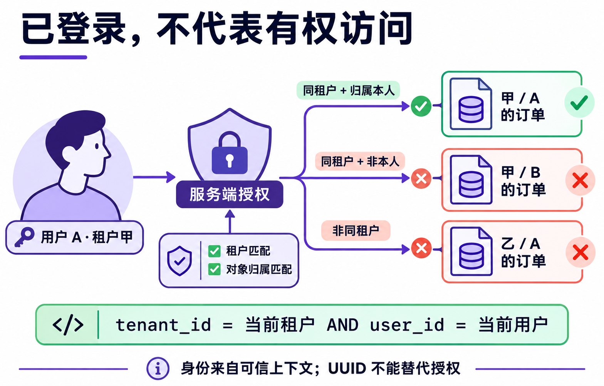
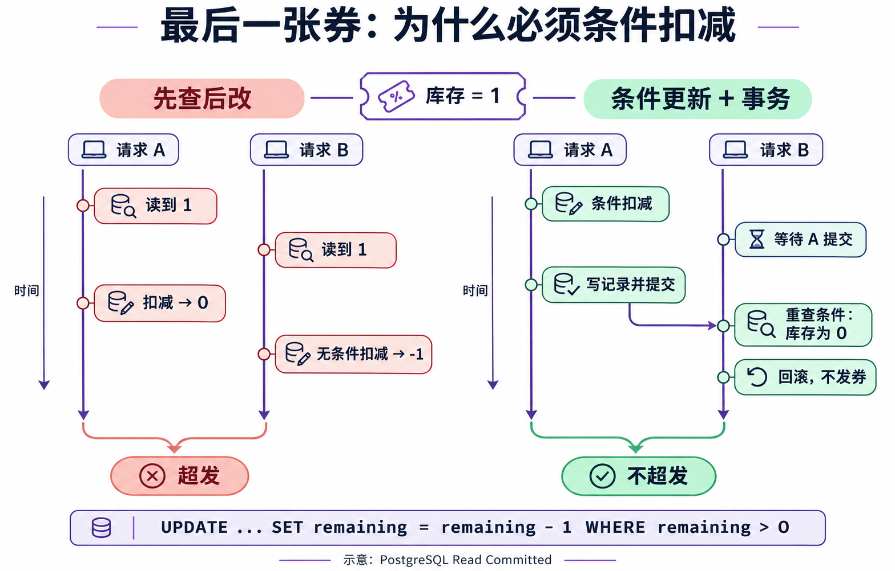
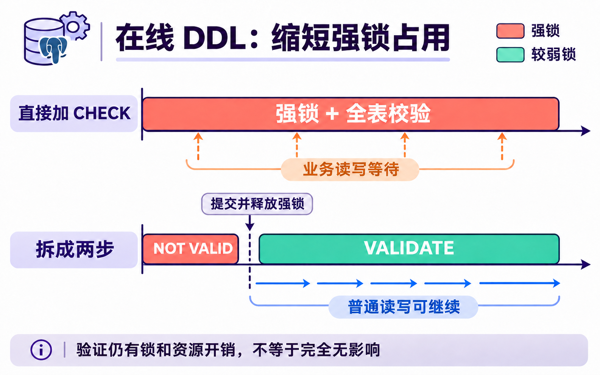
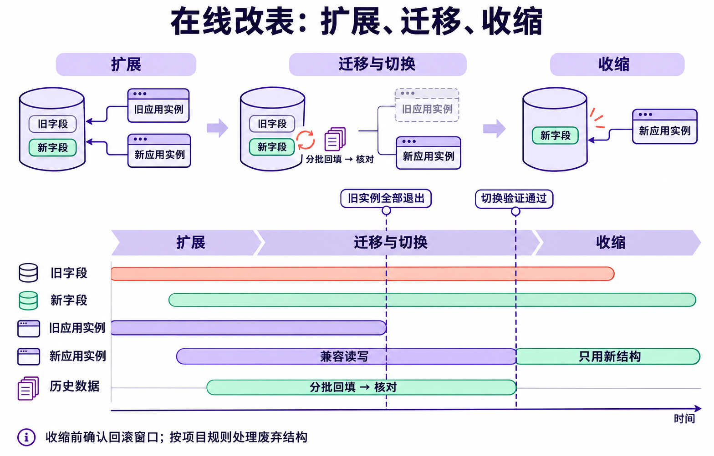
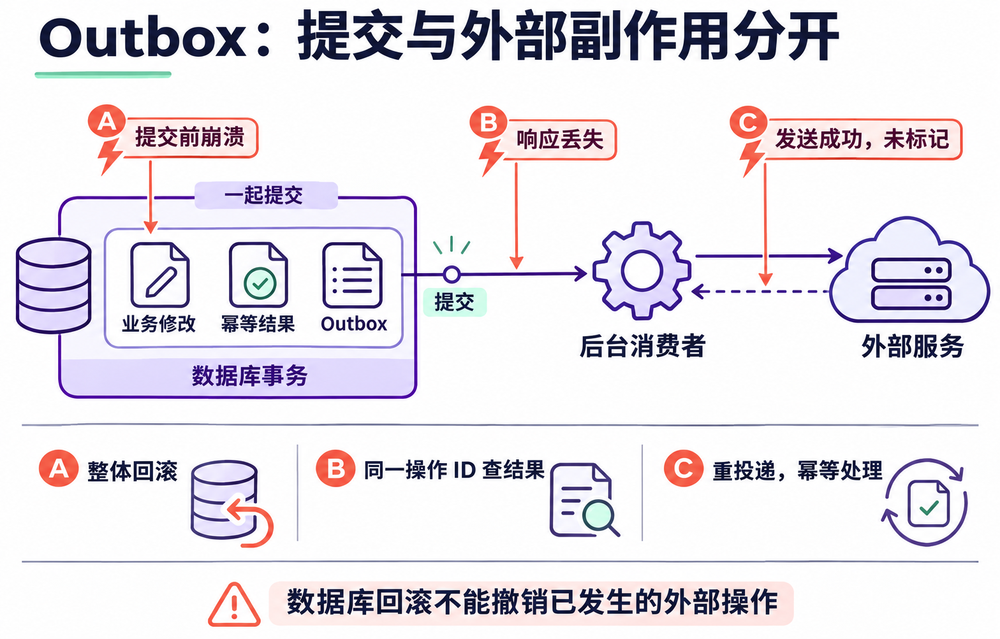

# Web 应用安全的八层防线

一个“领取优惠券”接口，即使使用了 HTTPS、要求登录、加了 Redis 锁，也可能存在漏洞：用户修改活动 ID，领到了其他租户的券；重复请求绕过次数限制；并发操作扣出了负库存；日志把登录凭证记录下来。

这些问题发生在不同位置，需要不同的防护。理解 Web 安全，既要知道 XSS、JWT、事务等概念，也要能沿着一次真实请求，指出每个风险由谁处理、在哪里阻止，以及失败后怎样恢复。

本文以 React/Vue、Nginx、Node.js/Python、PostgreSQL、Redis 为背景，沿业务请求梳理八层防护，并把在线 DDL 放进数据与发布安全中。请求执行时要守住权限和数据约束；结构变化时还要维持锁、数据迁移与应用版本之间的兼容。这是一种工程分工方式，并非标准规定的固定八层。

## 一 先确定资产和信任边界

设计防护之前，先回答三个问题：要保护什么，谁可能访问它，哪些输入不能直接相信。

典型资产包括账号、登录会话、订单、余额、优惠券库存、租户数据、数据库凭据、备份，以及系统的可用性。攻击者不一定是未登录的陌生人，也可能是普通注册用户、权限较低的员工、被接管的第三方服务或依赖包。

因此，**通过上一层检查，不代表下一层可以放弃校验。** 登录用户仍可能越权，内网请求仍可能携带恶意参数，数据库里保存的评论仍可能包含不可信 HTML。



图 1 沿请求处理顺序标出六个主要检查位置，底部两层覆盖全链路。攻击箭头表示相应的检查位置，不表示任何一层能拦截全部该类攻击。每向下一层传递数据，都需要继续验证这一层关心的事实；TLS 无法判断订单归属，认证也无法代替库存约束。

八层可以这样理解：

| 层级 | 保护目标 | 主要实施位置 |
| --- | --- | --- |
| 前端与浏览器安全 | 页面不执行不可信代码，用户会话不被滥用 | 前端代码、浏览器策略、服务端响应头 |
| 网络与网关安全 | 通信可信，入口流量和资源消耗受控 | CDN、Nginx、网关、网络设备 |
| 身份认证与权限安全 | 确认调用者及其可操作范围 | 身份服务、后端接口、数据访问层 |
| 业务逻辑安全 | 请求符合业务规则，不能重复获利 | 后端业务服务、后台任务 |
| 并发与数据一致性 | 同时执行或重试时仍保持业务约束 | 后端、数据库、协调服务 |
| 数据与存储安全 | 数据不被越权读取、篡改或泄露 | 数据访问层、数据库、缓存、备份 |
| 服务端与基础设施安全 | 限制代码执行、网络访问和权限扩散 | 应用、容器、主机、CI/CD、云平台 |
| 监控审计与灾难恢复 | 发现异常、保留证据、恢复服务和数据 | 全链路与运维流程 |

其中一些名称是攻击类型，例如 XSS、SSRF；一些是防护手段，例如 CSP、参数化查询；另一些是机制，例如 JWT、MVCC。不要把“使用了某个机制”等同于“这一类风险已经解决”。

## 二 前端与浏览器安全

浏览器安全主要保护页面执行环境和用户会话，但需要前后端共同实现。前端负责安全地使用数据，服务端负责设置策略和验证请求。



图 2 把三个常混淆的机制分别画出：XSS 利用了页面执行环境，CSRF 利用了浏览器携带凭证的行为，CORS 约束浏览器跨域访问响应。需要先找到问题发生的位置，再选择对应防护。

### XSS 的关键是数据进入了什么执行环境

跨站脚本攻击 XSS，通常发生在不可信内容被浏览器当成 HTML 或 JavaScript 解释时。

React 的普通文本插值会进行转义：

```jsx
function UserInfo({ name }) {
  return <div>{name}</div>;
}
```

但主动插入 HTML 会绕过这层保护：

```jsx
<div dangerouslySetInnerHTML={{ __html: userInput }} />
```

Vue 的 `v-html`、原生 DOM 的 `innerHTML` 也需要同样审查。富文本确实需要 HTML 时，应使用维护中的净化库，并按业务需要限制标签、属性和 URL 协议。普通文本、HTML 属性、URL、脚本位置具有不同规则，不能靠一个通用“过滤特殊字符”函数全部解决。[OWASP XSS 防护指南](https://cheatsheetseries.owasp.org/cheatsheets/Cross_Site_Scripting_Prevention_Cheat_Sheet.html)

CSP 可以限制脚本和其他资源的加载与执行，为 XSS 增加防线，但不能替代正确的渲染方式。部署时应结合实际资源来源设计策略，先观察违规报告，再逐步收紧，而不是照抄一条策略就认为页面安全。

### CSRF 取决于浏览器如何携带凭证

跨站请求伪造 CSRF 的典型条件是：浏览器自动携带目标站点的 Cookie，而服务端无法区分请求是否由用户认可的页面发起。

例如，用户已经登录，访问恶意页面后，该页面诱导浏览器向业务接口提交修改请求。如果后端只检查“Cookie 对应的用户已登录”，就可能执行非用户本意的操作。

采用 Cookie 会话时，应优先使用框架提供的 CSRF 防护，对修改状态的请求验证 CSRF Token，并结合来源校验及合适的 Cookie 属性。`SameSite` 是补充防线，不能一概替代其他措施；GET 接口也不应承担删除、转账等状态变更。[OWASP CSRF 防护指南](https://cheatsheetseries.owasp.org/cheatsheets/Cross-Site_Request_Forgery_Prevention_Cheat_Sheet.html)

### 凭证存储需要理解取舍

| 方式或属性 | 能提供的保护 | 需要注意的边界 |
| --- | --- | --- |
| HttpOnly Cookie | 阻止页面 JavaScript 直接读取 Cookie | XSS 仍可能借用户会话发起操作 |
| Secure Cookie | 限制 Cookie 通过安全连接发送 | 不解决越权、XSS 或服务端泄露 |
| SameSite Cookie | 限制部分跨站请求携带 Cookie | 需要匹配登录和跨站业务，不能泛化为全部 CSRF 防护 |
| localStorage | 方便前端持久保存数据 | 同源脚本可读取，XSS 可能窃取令牌 |
| 内存保存令牌 | 减少长期落盘 | 仍受当前页面恶意脚本影响，刷新后的会话恢复需另行设计 |

不存在适用于所有项目的“绝对安全存储位置”。要根据应用形态设计短期访问凭证、续期、注销和撤销机制，同时减少令牌进入 URL、错误上报、埋点和日志的机会。

点击劫持则关注页面被嵌入恶意站点后，用户是否会误触敏感操作。可通过 CSP 的 `frame-ancestors` 限定允许嵌入页面的来源，按兼容需求配合 `X-Frame-Options`。

**这一层可以直接检查：** 用户评论是否作为文本显示，富文本是否经过净化，敏感 Cookie 属性是否正确，恶意站点嵌入是否被拒绝，状态修改接口是否验证请求来源及 CSRF 防护。

## 三 网络与网关安全

这一层要保证传输安全，并在请求消耗大量后端资源之前施加约束。

HTTPS 使用 TLS 提供传输加密、完整性和服务器身份认证，但无法保证接口业务正确。证书终止在 CDN 或网关后，还要按部署网络的风险保护网关到后端这一段。

### CORS 控制浏览器跨域读取能力

CORS 不是接口权限系统。它通过响应头告诉浏览器，哪些来源的脚本可以跨域访问响应；某些请求需要先通过预检，另一些请求可以直接发出。即使浏览器不让脚本读取响应，请求本身仍可能已经执行，服务端脚本也不受浏览器 CORS 限制。[MDN CORS 文档](https://developer.mozilla.org/en-US/docs/Web/HTTP/Guides/CORS)

因此，不能用“只允许公司域名跨域”代替认证，也不能依赖 CORS 单独解决 CSRF。允许携带 Cookie 的跨域访问时，应维护明确的来源白名单，不能不加校验地回显任意 `Origin`。

### 流量限制需要覆盖不同成本

IP 限流适合控制部分入口滥用，但共享出口可能造成误伤，攻击者也可能使用多个地址。登录、短信、导出、文件解析等接口还需要按账号、租户、设备或业务资源限制频率和并发。

| 控制项 | 主要避免的问题 |
| --- | --- |
| 请求体和上传大小限制 | 大请求占满内存、磁盘或带宽 |
| 连接、读取和应用总时限 | 慢请求、卡住的上游长期占用资源 |
| 分页上限、批量数量和查询复杂度限制 | 单个合法请求消耗过多资源 |
| 并发数与队列长度限制 | 瞬时流量压垮线程池、连接池或任务队列 |
| WAF | 拦截部分已知攻击模式，辅助规则防护 |
| 上游 DDoS 防护 | 在流量到达业务带宽和服务器前缓解攻击 |

Nginx 不能在本机带宽已经耗尽后凭空恢复可用性；WAF 也很难判断“这个用户是否属于这个租户”这样的业务事实。

经过反向代理时，还应配置可信代理范围。不能直接相信客户端传入的 `X-Forwarded-For`、用户 ID 或角色头。若身份由网关注入，必须限制后端访问入口，并清除客户端同名头，避免绕过网关或伪造身份。

**这一层可以直接检查：** 超大请求是否被拒绝，昂贵接口是否有资源上限，伪造转发头是否影响限流身份，后端端口是否可以绕过网关直接访问。

## 四 身份认证与权限安全

认证回答“你是谁”，授权回答“你能对哪个资源做什么”。认证成功只代表身份被确认，不代表拥有全部业务权限。

### JWT 和 Session 都需要完整的会话设计

Session 通常由服务端保存会话状态，浏览器携带会话标识。JWT 是一种声明载体，常见的签名 JWT 保护声明完整性，并不对载荷保密，也不自动实现注销或即时撤权。

使用 JWT 时，服务端要使用可信密钥和明确允许的算法验证签名，并按协议验证有效期、签发者、受众等声明。仅解码载荷并读取 `userId` 不算认证。涉及即时撤权时，需要结合会话状态、令牌版本或其他撤销机制设计。

OAuth 2.0 是授权框架；第三方登录通常还需要 OpenID Connect 等身份层。浏览器和移动端的授权流程应使用成熟实现，正确处理重定向地址、`state`、PKCE，以及相应流程中的 `nonce`，避免自制协议。

账号安全还包括登录限流、管理员多因素认证、会话轮换、找回密码及修改邮箱等流程。只保护登录页面而忽略账号恢复入口，会留下另一条接管路径。

### 权限必须落到具体资源



图 3 使用“普通用户只能访问本租户内本人订单”的规则。同一个登录会话，访问不同资源时会得到不同结果：身份不变，资源归属和租户范围仍然需要逐次判断。

假设用户请求订单：

```http
GET /api/orders/10001
```

后端不能只查订单是否存在。对“用户查看本人订单”这个场景，查询应带上可信身份和租户范围：

```sql
SELECT id, status, total_amount
FROM orders
WHERE id = $1
  AND tenant_id = $2
  AND user_id = $3;
```

这里的 `$2`、`$3` 来自服务端验证过的上下文。用户可以选择租户，但服务端必须验证其成员关系，不能直接信任请求里的 `tenantId`。

RBAC 通过角色表达权限，例如管理员可以管理活动；ABAC 根据用户、资源和环境属性判断，例如只能管理本租户且尚未结束的活动。两者可以组合，关键是每次操作都检查实际资源范围，并默认拒绝未明确允许的访问。[OWASP 授权指南](https://cheatsheetseries.owasp.org/cheatsheets/Authorization_Cheat_Sheet.html)

IDOR 指通过修改资源标识访问了不属于自己的对象。使用 UUID 可以增加猜测难度，但不能代替授权。列表、详情、导出、附件下载、批量操作和后台任务都需要遵守相同的数据边界。

**这一层可以直接检查：** 用户 A 是否能读取或修改用户 B 的订单，普通用户能否直接调用管理接口，切换租户参数能否访问其他租户，权限撤销后会话是否按设计失效。

## 五 业务逻辑安全

业务攻击往往使用完全合法的 HTTP 和 JSON，只是利用了系统没有验证的规则。

例如领取优惠券，请求至少需要通过这些判断：活动属于当前租户，活动处于可领取时段，用户满足资格，没有超过领取上限，库存足够。

### 客户端提交意图 后端计算结果

客户端可以提交商品、数量、所选优惠券，但价格、可用折扣和最终应付金额应由后端可信数据计算。金额计算应使用适当的十进制定点表示或最小货币单位，明确币种和舍入规则。

参数校验也不只是“字段类型正确”。数量为整数还不够，还要检查是否为正数、是否超过业务上限，相关商品是否允许当前用户购买。

更新资料等接口应明确允许修改的字段，避免把整个请求体直接写入模型。否则用户可能额外提交 `role`、`tenant_id` 或 `is_admin`，形成批量赋值漏洞。

### 幂等 防重放和防刷解决不同问题

| 问题 | 示例 | 主要处理方法 |
| --- | --- | --- |
| 重试导致重复效果 | 网络超时后重复创建订单 | 稳定幂等键、唯一约束、已有结果查询 |
| 旧请求被再次利用 | 攻击者重复发送有效回调 | 验签、时效校验、事件去重 |
| 大量不同请求滥用资源 | 多账号批量领取补贴 | 多维限流、配额、风险控制、业务资格约束 |

幂等键需要绑定调用者、业务范围和关键参数。同一个键配上不同参数，应返回冲突。攻击者每次换一个键，仍然不能绕过“每人限领一次”这样的业务约束。

支付回调或第三方通知还应按对方协议验证签名，并检查金额、币种、订单归属及允许的状态迁移。请求体里写着 `status=paid`，不代表订单真的支付成功。

**这一层可以直接检查：** 修改价格是否影响结算，传入额外权限字段是否被拒绝，同一请求重试是否返回同一业务结果，已取消订单是否能被旧消息错误地改回已支付。

## 六 并发与数据一致性

并发错误可能造成超卖、重复发券或重复扣款，因此也是业务安全的一部分。

“先查询是否领过，再插入领取记录”在串行执行时看似正确，两个请求同时执行时却可能都查询到没有记录。应用里的判断需要由数据库约束和原子操作支撑。

### 让业务不变量落实到数据库



图 4 左侧的两个请求都读到库存为 1，无条件扣减最终导致超发。右侧以 PostgreSQL 默认的 Read Committed 隔离级别为例：第二个扣减等待第一个事务结束后，重新判断更新条件，库存为 0 时不再发券。更高隔离级别下也可能报告并发冲突，需要回滚并重试整个事务。[PostgreSQL 事务隔离文档](https://www.postgresql.org/docs/current/transaction-iso.html)

对“同一租户中，每人对每个活动只能领一次”这个规则，可以使用：

```sql
UNIQUE (tenant_id, campaign_id, user_id)
```

库存扣减使用条件更新：

```sql
UPDATE coupon_campaigns
SET remaining = remaining - 1
WHERE id = $1
  AND tenant_id = $2
  AND remaining > 0
RETURNING id;
```

没有返回行，表示没有满足条件的记录，不能继续发券。领取记录、库存扣减和需要持久化的结果应放在同一个事务中；后续插入失败时，前面的扣减也应回滚。

复杂的读取后修改可以使用短事务和行锁；用户编辑配置适合使用版本号条件更新；涉及多行时应统一加锁顺序，并对死锁或序列化失败有限重试整个事务。

MVCC 帮助数据库管理并发可见性，不代表任意“先查后改”都自动安全。数据库隔离级别、SQL 形式和约束共同决定结果。

### 锁 事务和幂等各有边界

- 锁协调同时执行，但释放锁后仍可能收到重复请求。
- 事务回滚数据库修改，但不能撤回已经发送的邮件或 HTTP 请求。
- 唯一约束保证指定键的唯一性，但不检查用户是否有资格领取。
- 租约到期不会停止旧进程，严格保护写入时还需要执行身份或代次校验。

数据库保存后必须可靠触发后台任务，可以在同一个事务中写 Outbox，再由消费者重试发送。消费者要处理重复消息；外部操作超时后，应按稳定操作 ID 查询或幂等重试，不能直接认定失败。

具体事务边界和失败恢复可以继续阅读 [业务中的锁与事务](分布式理论/分布式协调与同步/业务中的锁与事务：16种场景与失败恢复.md)。

**这一层可以直接检查：** 同一用户并发领取是否只有一条记录，不同用户竞争最后一张券是否只成功一次，中途异常是否同时回滚库存和领取记录，任务重复投递是否重复发放权益。

## 七 数据与存储安全

这一层既要防止数据被非法查询，也要减少数据库、缓存或备份泄露后的影响。

### 参数化查询与权限过滤都要有

参数化查询把 SQL 结构和数据值分开，避免输入被解释成 SQL。动态表名、排序字段等不能直接当作普通参数绑定，应由后端固定映射到允许的选项；ORM 的原始 SQL 接口也需要审查。[OWASP SQL 注入防护指南](https://cheatsheetseries.owasp.org/cheatsheets/SQL_Injection_Prevention_Cheat_Sheet.html)

防注入不等于防越权：一条参数化查询如果没有租户范围，仍然可能泄露其他租户的数据。同样，缓存键也应包含必要的租户、用户或权限范围，不能只因为两个请求访问相同资源 ID 就共用敏感结果。

### 密码 哈希和加密不能混用

密码需要使用适合密码存储的慢哈希算法，例如 Argon2id，并使用成熟库管理盐和参数。不能明文保存，也不应仅做一次 SHA-256，更不能把 Base64 当成加密。[OWASP 密码存储指南](https://cheatsheetseries.owasp.org/cheatsheets/Password_Storage_Cheat_Sheet.html)

需要还原的敏感数据才考虑加密。加密设计还要解决密钥访问、轮换、备份和审计；把密文和所有解密凭据放在相同权限边界中，保护效果有限。磁盘加密可以保护部分介质泄露场景，但不能阻止已获授权的应用查询并外传数据。

### PostgreSQL 和 Redis 都应限制访问范围

应用数据库账号不应使用超级用户权限。迁移账号与日常运行账号可以分离；管理入口、备份和只读分析账号也应按用途授权。

Redis 应置于受控网络，按部署需要启用 TLS，并使用 ACL 限制用户可执行的命令和可访问的键。一个复杂密码不能替代网络隔离；缓存、会话、队列和分布式锁具有不同的数据重要性，也应分别设计持久化和故障行为。

数据最小化同样重要：不需要保存的敏感字段就不收集，接口只返回必要字段，导出文件设置访问范围和有效期，过期数据按业务及适用要求清理。

**这一层可以直接检查：** 原始 SQL 是否拼接输入，运行账号能否修改无关表，缓存是否跨租户复用，备份下载是否需要授权，生产凭据是否进入代码或前端构建产物。

### 在线 DDL 先判断锁 再考虑发布

业务接口运行时需要并发控制，修改它依赖的表结构时也一样。DDL 会改变字段、索引或约束，一次结构修改可能让整个接口失去可用性：迁移在等表锁，请求在迁移后面排队，连接池逐渐被耗尽。

这一部分以 [从真实项目学 PostgreSQL 第 11 篇 在线 DDL](https://github.com/congwa/agent-dev/blob/main/2026-08_%E4%BB%8E%E7%9C%9F%E5%AE%9E%E9%A1%B9%E7%9B%AE%E5%AD%A6PostgreSQL/11-%E5%9C%A8%E7%BA%BFDDL.md) 的工程思路展开：把阻塞、历史数据转换和应用兼容分别设计，再通过迁移执行器把规则落实。

判断一条 DDL，需要依次看四件事：

1. **拿什么锁**：普通查询、写入、维护任务和其他 DDL，哪些会与它冲突？
2. **什么时候拿得到**：是否有长事务或空闲未提交事务挡在前面？
3. **拿到后做多久**：只是改元数据，还是扫描数据、重建索引或重写整张表？
4. **谁还在使用旧结构**：旧应用、后台任务、导出程序和回滚版本是否仍然能运行？

“锁级别 × 持有时长”是记忆风险的方式，不是量化计算公式；还要考虑等待队列、数据规模和业务负载。即使修改元数据很快，也可能在获取强锁时等待，随后影响排在后面的请求。

### 把长操作从强锁阶段移出去



图 5 以增加 CHECK 约束为例，时间长度仅作机制示意。直接添加需要在检查历史数据期间持有强锁；拆成 `NOT VALID` 与 `VALIDATE` 后，可以先用短事务建立约束，再用较弱锁检查历史数据。**第一步必须先提交，再开始第二步**，否则事务仍会保留前面拿到的强锁，失去拆分的主要收益。

| 操作 | 主要影响 | 选择方式 |
| --- | --- | --- |
| 加普通字段，或加非易变默认值的字段 | 仍需强表锁；现代 PostgreSQL 中通常可避免因默认值重写表 | 使用短事务，控制等锁时间 |
| 加带易变默认值的字段 | 可能逐行求值并重写表 | 先扩展结构，单独设计历史数据转换 |
| 改类型，例如 `integer` 到 `bigint` | 可能重写表及相关索引 | 大表优先评估新列、兼容写入、回填与切换 |
| 直接增加 CHECK | 扫描历史数据时持有强锁 | 分开添加 `NOT VALID` 和执行 `VALIDATE` |
| 普通建索引 | 允许普通读，但阻塞写入 | 持续写入的普通表评估 `CONCURRENTLY` |
| 改字段名或删除字段 | 元数据操作也要拿锁，并可能立即破坏调用方 | 先消除应用依赖，再安排结构操作 |

默认值的分类要准确：PostgreSQL 11 起，新增列的非易变默认值可以使用快速路径。`now()`／`CURRENT_TIMESTAMP` 属于 `STABLE`，不能与 `random()`、`clock_timestamp()` 这类易变函数混为一谈。具体类型转换是否重写也存在例外，不能把所有 `ALTER TYPE` 都写成同一结论。[PostgreSQL ALTER TABLE](https://www.postgresql.org/docs/current/sql-altertable.html)、[函数易变性分类](https://www.postgresql.org/docs/current/xfunc-volatility.html)

例如，给 `orders.amount_new` 增加非空保护，可以分步执行：

```sql
-- 步骤 1：短事务建立约束。历史数据暂不扫描，新写入和更新仍需满足约束。
BEGIN;
SET LOCAL lock_timeout = '3s';
SET LOCAL statement_timeout = '30s';
ALTER TABLE orders
  ADD CONSTRAINT orders_amount_new_nn
  CHECK (amount_new IS NOT NULL) NOT VALID;
COMMIT;
```

```sql
-- 步骤 2：第一步提交后，在另一个事务里验证历史数据。
BEGIN;
SET LOCAL lock_timeout = '3s';
SET LOCAL statement_timeout = '10min';
ALTER TABLE orders VALIDATE CONSTRAINT orders_amount_new_nn;
COMMIT;
```

验证阶段使用的 `SHARE UPDATE EXCLUSIVE` 锁允许普通读写，但可能与 VACUUM、ANALYZE 和其他结构操作冲突，也会消耗 I/O。数据不合规时验证会失败，需要修复数据后重试；不能跳过校验就宣布约束已经覆盖历史记录。示例时限需按实际规模调整。[PostgreSQL 锁模式](https://www.postgresql.org/docs/current/explicit-locking.html)

经过验证的等价 CHECK 可以帮助后续 `SET NOT NULL` 避免再次扫描，但该操作仍需要相应锁。`NOT VALID` 也不能泛化到所有约束；唯一性不是通过 `ADD UNIQUE ... NOT VALID` 来解决的。

这里展示 PostgreSQL 机制；具体项目是否允许 CHECK、外键或结构清理，应按该项目规则选择。仓库的 [数据库开发规则](../f-database/数据库开发规则.md) 包含更严格的限制，不能把机制示例直接当成项目迁移方案。

### 并发建索引必须独立安排执行边界

对正在持续写入的普通表，可以评估：

```sql
-- 单条语句独立执行，不放在 BEGIN / COMMIT 内。
CREATE INDEX CONCURRENTLY IF NOT EXISTS idx_orders_tenant_created
  ON orders (tenant_id, created_at);
```

普通建索引会让写请求等待；并发建索引通过多阶段扫描和等待，允许普通写入继续。它通常需要更多总工作量，并非更快，也不是没有锁。资源负载、长事务和并发 DDL 都可能让执行时间增加。[PostgreSQL 并发建索引](https://www.postgresql.org/docs/current/sql-createindex.html#SQL-CREATEINDEX-CONCURRENTLY)

并发构建失败后，先检查索引定义、有效状态和失败原因，特别是唯一索引是否仍影响写入。`IF NOT EXISTS` 只避免同名对象报错，不会把无效索引自动修好，也不会检查列、条件和排序是否一致。

迁移工具必须支持非事务步骤，逐条执行需要独立事务边界的语句。`_notx.sql` 是参考项目的命名约定，不是 PostgreSQL 的特殊文件格式；是否生效取决于执行器。不能仅改文件名，仍把全部 SQL 打包进一次事务或一次多语句提交。

### 历史数据回填是一项可恢复任务

改字段类型时，直接重写大表可能长时间占用强锁；把新字段加出来，也并不等于完成迁移。还需要保证迁移期间新写入不会遗漏，并核对历史数据是否按正确规则转换。



图 6 把结构可用期和应用使用期放在同一条时间轴上。新旧字段先共存，新应用先具备兼容能力；双写或同步机制覆盖所有写入口后，再回填并核对数据。确认旧实例和旧任务退出、回退窗口允许后，才处理废弃结构。

每批回填应有明确的范围和进度：

```text
读取已保存的进度和本轮迁移范围
→ BEGIN
→ 按稳定主键选取下一批待转换记录
→ 按当前记录值转换，避免旧快照覆盖并发更新
→ 保存本批实际处理范围和进度
→ COMMIT
→ 根据复制延迟、锁等待和业务延迟限速
→ 继续下一批；失败时从已提交进度恢复
→ 完成后复核遗漏、转换结果和所有写入口
```

每批一个事务，控制锁持有时间和单批 WAL 压力；批量大小按生产规模演练，不照搬固定行数。进度必须对应实际选中和提交的记录，不能用另一条范围不同的查询随意推进游标。存在跳过行、晚到记录或并发修改时，还要安排补扫和最终核对。

双写也需要明确谁是当前权威数据源、何时切换，以及回滚旧应用后是否会产生无法表达的新值。单纯“同时写两列”并不能自动保证兼容。

### 迁移执行器需要落实的规则

| 规则 | 要防止的失败 |
| --- | --- |
| 单一迁移入口，或用 advisory 锁串行化 | 多副本启动时同时修改结构 |
| 区分事务与非事务步骤 | 并发建索引被错误包进事务 |
| 记录迁移名、校验和与成功状态 | 历史文件被修改后，各环境实际结构分叉 |
| 可重入执行并核对对象定义 | 中断后重跑被同名残留对象误导 |
| 事务内设置局部超时 | 长时间等锁，或迁移占用资源超出预算 |
| 实际结构及业务读写核对 | 只看迁移记录成功，却没有获得预期能力 |

如果使用会话级 advisory 锁，需要在同一个专用连接上获取、执行和释放；不能通过连接池在连接 A 上拿锁，再假设连接 B 自动受它保护。它防止遵守协议的迁移执行者互相竞争，不能代替数据库自身的 DDL 锁。[PostgreSQL advisory 锁](https://www.postgresql.org/docs/current/explicit-locking.html#ADVISORY-LOCKS)

事务迁移中的 `SET LOCAL` 随提交或回滚结束；非事务步骤需要在专用会话中另外管理超时，避免把会话设置残留到连接池。SQL 生成工具或 Alembic 的使用入口可见 [SQLAlchemy 笔记](../p-python/SQLAlchemy.md)，生成出的脚本仍需逐条审查。

### 迁移失败先确认真实状态

- **短事务尚未提交**：回滚，定位阻塞者或约束错误，修复后有限重试。
- **非事务步骤部分成功**：核对已创建的对象和索引状态，再决定修复或继续，不能假设整份文件已经回滚。
- **回填中断**：保留已经提交的批次和进度，恢复任务并复核遗漏。
- **结构已更新但应用发布失败**：优先保留兼容结构并回滚应用，避免立即反向改表造成第二次故障。

上线期间至少观察锁等待、连接池、慢查询、CPU／I/O、WAL 与复制延迟。停止迁移之前先确认其事务边界；恢复备份之前还要评估备份之后的业务写入和外部副作用。应用回滚、迁移回退和数据恢复是三种不同动作，不能用一个 `downgrade` 概括。

## 八 服务端与基础设施安全

这一层关注攻击者能否借应用访问内网、执行代码，或者在攻陷一个服务后扩大影响。SSRF、文件上传和命令注入首先需要应用防护，容器和网络隔离负责进一步限制损害。

### SSRF 需要同时约束目标与出口

服务器抓取用户提供的图片 URL、网页链接或 Webhook 地址时，可能被诱导访问本机、内网服务或云元数据接口。

若业务只需要访问有限服务，应采用明确的目标白名单；需要访问任意公网地址时，要使用可靠 URL 解析，限制协议和端口，检查解析后的 IPv4/IPv6 地址，拒绝不允许的地址范围，并禁用重定向或逐跳重新校验。只判断字符串“不包含 localhost”远远不够。[OWASP SSRF 防护指南](https://cheatsheetseries.owasp.org/cheatsheets/Server_Side_Request_Forgery_Prevention_Cheat_Sheet.html)

网络出口策略可以进一步限制访问范围。应用检查需要与实际连接行为一致，避免 DNS 变化或重定向让请求最终连接到另一个地址。

### 文件上传不能只看后缀

上传内容应限制大小和类型，使用服务端生成的存储标识，并根据处理方式校验内容。图片解码、PDF 转换、压缩包解压等任务也要限制 CPU、内存、输出大小和执行时间。

文件不应放进可执行目录。HTML、SVG 等主动内容若允许上传，需要考虑独立来源或附件下载方式，避免以业务站点的权限执行。下载时仍然需要授权，解压时要阻止路径穿越。

### 限制执行权限和供应链影响

避免把用户输入拼接进 shell 命令；确需调用程序时，使用明确的可执行文件和参数数组，并限制允许参数。模板执行、不可信反序列化和动态代码执行同样需要审查。

容器应尽量以非 root 用户运行，减少 Linux capabilities，避免特权模式及挂载 Docker socket，并配置资源限制。非 root 不代表容器天然安全，宿主机、运行时和依赖仍要维护。

供应链防护覆盖 npm、Python 包、容器基础镜像和 CI/CD 插件。锁文件与可复现构建有助于确定实际使用了什么，漏洞扫描和修复流程负责持续处理风险；锁定版本本身不保证包没有恶意代码。

部署凭据、签名密钥和 API Key 应通过受控密钥系统注入，限制 CI 权限并支持轮换。前端构建时注入的变量最终可能进入浏览器，不能用于保存服务端秘密。

**这一层可以直接检查：** 抓取接口能否访问不允许的网络目标，上传文件能否作为站点脚本执行，容器能否修改不需要的目录，CI 作业是否拿到了超出任务范围的密钥。

## 九 监控审计与灾难恢复

前面七层减少问题发生的机会，这一层解决发生后如何发现、止损和恢复。

### 日志应记录可追踪事实

一条领取记录可以包含：

```json
{
  "requestId": "req-example",
  "operationId": "claim-example",
  "tenantId": "tenant-example",
  "actorId": "user-example",
  "action": "coupon.claim",
  "resourceId": "campaign-example",
  "result": "rejected",
  "reasonCode": "OUT_OF_STOCK"
}
```

日志应能回答谁在何时对什么做了什么，结果如何。涉及个人数据的字段需要控制访问和保留期限；不能记录密码、完整 Token、Cookie、数据库连接串或完整敏感请求体。日志内容还应结构化处理，避免外部输入伪造额外日志行。[OWASP 日志指南](https://cheatsheetseries.owasp.org/cheatsheets/Logging_Cheat_Sheet.html)

调试日志、指标和审计记录用途不同。管理员改权限、密钥轮换、数据导出等高风险动作需要更严格的审计访问控制和防篡改措施，不能只依赖可能被本机攻击者删除的普通日志。

### 告警需要对应处理动作

登录失败激增、越权拒绝异常、库存对账不一致、大规模导出、异常网络出口和管理员权限变化，都可以成为告警信号。每类告警需要明确接收人、排查入口和处置动作，避免只有图表、没有人处理。

发生凭据泄露后，删除代码里的秘密还不够，需要撤销或轮换已泄露凭据；发生入侵后，还要保留证据、缩小访问范围，确认恢复环境的可信性。

### 备份只有成功恢复后才验证了价值

备份需要与生产环境适当隔离，限制删除权限，并保护解密密钥。数据库复制可以提高可用性，但误删和恶意修改也可能同步到副本，所以副本不能替代历史备份。

恢复目标应具体表达为：

- **RPO**：最多能接受丢失多长时间的数据。
- **RTO**：故障后最多能接受多长时间恢复服务。

在隔离环境演练恢复时，要验证数据、权限、密钥、应用版本和业务对账，而不是只检查备份文件存在。恢复历史数据后，还要核对支付、发货等外部系统的实际状态，避免把已经发生的操作重复执行。

## 十 用领取优惠券串起八层防护

假设规则是“一个租户内，每位用户对一个活动最多领取一张券”，可以这样组织流程：

```text
浏览器
→ 安全渲染活动内容
→ 提交 campaignId 和稳定的 operationId
→ Cookie 会话携带相应 CSRF 防护

网关
→ HTTPS、可信代理处理
→ 限制请求大小、频率和并发

后端
→ 验证会话
→ 验证租户成员关系和活动访问权限
→ 校验参数、领取资格和活动规则

数据库短事务
→ 按租户、用户、操作类型、operationId 处理幂等记录
→ 对首次请求锁定活动行，重新检查活动状态与有效期
→ 原子扣减库存；无可用库存则回滚
→ 插入领取记录，由唯一约束保证每人限领一次
→ 保存业务结果及必要的 Outbox 事件
→ 提交

后台
→ 消费 Outbox，发送通知
→ 处理重复消息与失败重试

全链路
→ 记录必要的审计信息和指标
→ 对异常拒绝、任务积压及数据差异告警
```

活动规则若允许并发修改，需要定义修改与领取之间的顺序；示例通过事务内锁定活动行，让相关修改路径遵守同一套协调规则。重复领取导致唯一约束冲突时，应回滚本次扣减，再按业务语义查询已有领取结果，不能吞掉异常后继续提交。



图 7 将数据库提交与外部副作用分开。提交前失败依赖事务回滚；提交后失败依赖持久化结果和待发事件；外部操作可能已经成功时，依赖查询确认和幂等。Outbox 的“发送成功”仍需按所用通道确认交付语义，不能直接等同于目标业务执行成功。

最后还要检查三个故障点：

| 故障位置 | 期望行为 |
| --- | --- |
| 数据库提交前进程崩溃 | 库存、领取记录、幂等结果和 Outbox 一起回滚 |
| 提交后响应丢失 | 使用相同 operationId 重试，返回已有结果 |
| 通知已发出但未标记完成 | 允许再次投递，接收或处理端去重，避免重复副作用 |

这些防护相互补充。入口限流控制滥用成本，认证和授权确定操作范围，数据库约束守住业务不变量，幂等处理重试，Outbox 处理通知恢复，审计帮助发现并定位异常。

## 十一 按风险安排学习和实施顺序

学习时可以沿请求链路逐层展开；项目落地时，应优先处理高价值资产和实际暴露面。例如，公网后台缺少授权、数据库直接暴露、密钥已经泄露，都比补充漂亮的监控面板更紧急。

一套适合全栈开发者的学习顺序是：

1. 理解浏览器同源策略、XSS、Cookie、CSRF 和 CORS 的边界。
2. 掌握会话生命周期、对象级授权、多租户隔离和账号恢复。
3. 用实际业务练习参数校验、状态机、幂等、条件更新、事务和唯一约束。
4. 学会参数化查询、密码存储、最小权限、DDL 安全迁移、密钥管理和备份恢复。
5. 继续掌握网关资源限制、SSRF、文件处理、容器与供应链防护。
6. 为关键路径补齐审计、告警、故障恢复和对账流程。

每学一个概念，都试着回答：**它保护哪个资产，拦住哪一种失败，判断发生在哪里，绕过这一层之后还有什么约束，以及如何直接验证它确实有效。**

## 参考资料与配图

在线 DDL 的工程主线参考 [从真实项目学 PostgreSQL 第 11 篇 在线 DDL](https://github.com/congwa/agent-dev/blob/main/2026-08_%E4%BB%8E%E7%9C%9F%E5%AE%9E%E9%A1%B9%E7%9B%AE%E5%AD%A6PostgreSQL/11-%E5%9C%A8%E7%BA%BFDDL.md)，锁、函数分类和操作边界以正文链接的 PostgreSQL 官方文档为准。原文实验耗时与硬件、数据和负载相关，本文不将其作为生产耗时承诺。

配图为重新绘制的机制示意，未复用网站原图。视觉组织参考 [pgroll 的结构迁移时序](https://pgroll.com/blog/introducing-pgroll-zero-downtime-reversible-schema-migrations-for-postgres) 和 [Cloudflare 的请求防护流程](https://blog.cloudflare.com/waf-attack-score-for-business-plan/)。图中时间条不代表实测时长。

图片及生成说明保存在 [配图目录](../imgs/web-security/README.md)。
